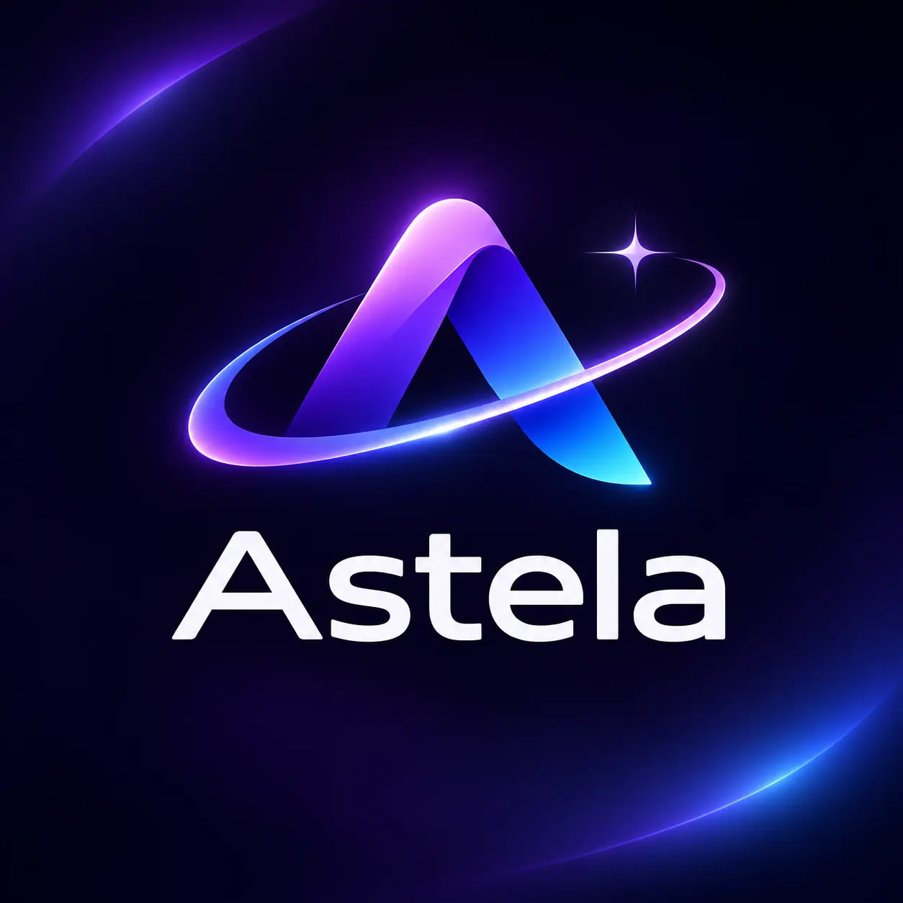
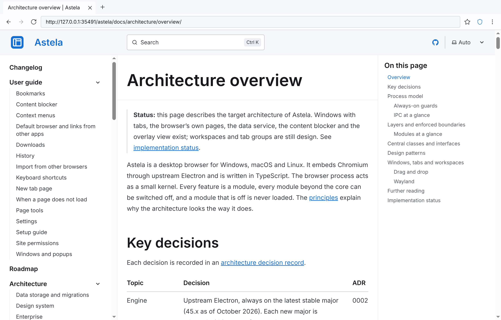

# Astela

A desktop browser for Windows, macOS and Linux, built on Chromium through Electron and written in TypeScript. It has no telemetry, no ads, no sponsored tiles, no news feed and needs no account.

> **Status:** early development. The current beta, 0.1.0-beta.5, is on the [releases page](https://github.com/Secoolioo/astela/releases); the [roadmap](docs/roadmap.md) lists every milestone.

<picture>
  <source media="(prefers-color-scheme: dark)" srcset="assets/screenshots/screenshot-dark.png">
  
</picture>

## In place

- **Browsing:** tabs at the top, at the bottom or at either side, find in page, zoom per site, full screen, downloads, site permissions, popups and private windows; a page that cannot load says why.
- **Your data:** history with search, bookmarks with a bar, session restore, and the import of bookmarks, history and open tabs from other browsers.
- **Content blocker** with the default filter lists of uBlock Origin, on from the first start, with a switch per site.
- **Customization:** a settings page with search, themes and colors of your own, density, text size and fonts, a toolbar and a new tab page to arrange, search engines with keywords and `!bangs`, and keyboard shortcuts of your own.
- **Privacy:** no telemetry, HTTPS-First, DNS over HTTPS, blocked third-party cookies and clearing browsing data.
- **Packages** for Windows (NSIS installer, MSI), macOS (disk image) and Linux (AppImage, deb, rpm), for x64 and arm64. CI installs and starts every format on every change.
- **Signed updates** with delta downloads. After two failed starts, the previous version comes back on its own. deb and rpm packages update through APT and DNF repositories.
- **Policies** from the Windows registry, macOS configuration profiles and JSON files on Linux, read before the first window opens.
- **Performance budgets**, measured against a bare Electron app on all three systems for every change: start-up at most 120 ms and 25 % slower than the bare app (on macOS still a target: its CI runners show 10 to 60 %, and the gate there stops at 75 % until the shell starts faster), idle memory at most 60 MB above it (50 MB on macOS), idle CPU at most 0.5 % of one core. See [performance](docs/architecture/performance.md).
- **Security fixes** from Electron ship in a patch release within 72 hours, critical ones within 24 hours.

## New on main

On `main` now, and in the next beta, 0.1.0-beta.6:

- **Logo and colors:** a new logo and application icon; its violet is the default accent of the browser and the accent of its website, and its blue shows progress, such as a page that loads.
- **Tab icons:** each tab shows the icon of its page, a ring while the page loads and a button that mutes a tab that plays sound.
- **Tabs:** animate when they open, close and move, can be dragged to a new place and stay usable when many are open.
- **Pinned tabs and a tab menu:** a menu for each tab opens a tab next to it, duplicates, pins, mutes or closes tabs; keys choose tabs, and on Windows and Linux also move them.
- **Address bar:** shows the site first with a lock for HTTPS and **Not secure** for HTTP, and shows the loading of a page.

## Planned for 0.1.0

- Layout presets with tabs in an integrated title bar, suggestions in the address bar and menus in an overlay.
- A command palette, tab search, sleeping tabs, split view, tab groups, workspaces, a reader view and picture-in-picture.
- Saved passwords and autofill.

## Documentation

- [Architecture overview](docs/architecture/overview.md) and [decision records](docs/adr/README.md)
- [Design system](docs/architecture/design-system.md)
- [Maintainer workflow](docs/maintainers/WORKFLOW.md)

## Contributing

Contributions are welcome. Read [CONTRIBUTING.md](CONTRIBUTING.md) to get started and [SECURITY.md](SECURITY.md) to report vulnerabilities.

## License

Astela is licensed under the [Mozilla Public License 2.0](LICENSE).
