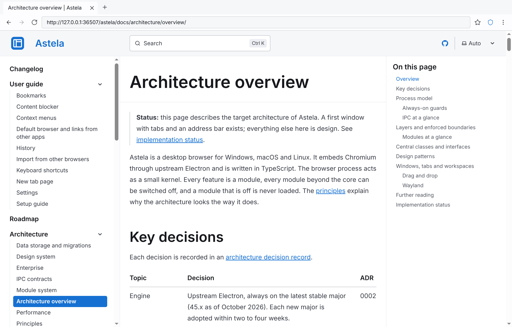

# Astela

A desktop browser for Windows, macOS and Linux, built on Chromium through Electron and written in TypeScript. It has no telemetry, no ads, no sponsored tiles, no news feed and needs no account.

> **Status:** early development. The current beta, 0.1.0-beta.3, is on the [releases page](https://github.com/Secoolioo/astela/releases); the [roadmap](docs/roadmap.md) lists every milestone.

<picture>
  <source media="(prefers-color-scheme: dark)" srcset="assets/screenshots/screenshot-dark.png">
  
</picture>

## In place

- **Packages** for Windows (NSIS installer, MSI), macOS (disk image) and Linux (AppImage, deb, rpm), for x64 and arm64. CI installs and starts every format on every change.
- **Signed updates** with delta downloads. After two failed starts, the previous version comes back on its own. deb and rpm packages update through APT and DNF repositories.
- **Policies** from the Windows registry, macOS configuration profiles and JSON files on Linux, read before the first window opens.
- **Performance budgets**, measured against a bare Electron app on all three systems for every change: start-up at most 120 ms and 25 % slower than the bare app (on macOS still a target: its CI runners show 10 to 60 %, and the gate there stops at 75 % until the shell starts faster), idle memory at most 60 MB above it (50 MB on macOS), idle CPU at most 0.5 % of one core. See [performance](docs/architecture/performance.md).
- **Security fixes** from Electron ship in a patch release within 72 hours, critical ones within 24 hours.

## Planned for 0.1.0

- Workspaces, tab bars on any side of the window, tab groups and layout presets.
- Themes with an editor, three density levels, custom shortcuts and a searchable settings page.
- History, bookmarks, downloads, session restore and private windows.

## Documentation

- [Architecture overview](docs/architecture/overview.md) and [decision records](docs/adr/README.md)
- [Design system](docs/architecture/design-system.md)
- [Maintainer workflow](docs/maintainers/WORKFLOW.md)

## Contributing

Contributions are welcome. Read [CONTRIBUTING.md](CONTRIBUTING.md) to get started and [SECURITY.md](SECURITY.md) to report vulnerabilities.

## License

Astela is licensed under the [Mozilla Public License 2.0](LICENSE).
