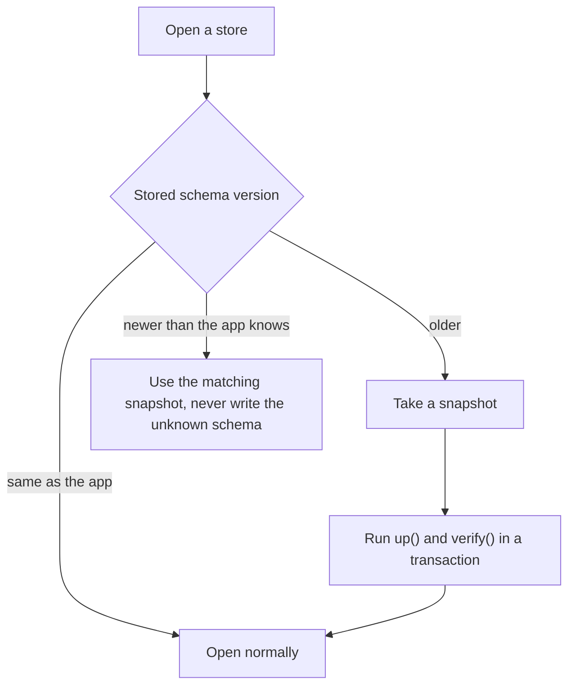

# Data storage and migrations

> **Status:** partly implemented. Settings and logs are stored as described; the rest of this page is design. See [implementation status](#implementation-status).

Astela keeps all user data local, in a small number of well-defined stores. Updates must never destroy data: every store has its own schema version, every migration is preceded by a snapshot, and an older app version never writes data it does not understand. The decision record is ADR 0009 (storage with node:sqlite); see the [decision record index](../adr/README.md).

## Stores

| Data                                                           | Storage                                                               | Details                                                                                                                                                                                          |
| -------------------------------------------------------------- | --------------------------------------------------------------------- | ------------------------------------------------------------------------------------------------------------------------------------------------------------------------------------------------ |
| Settings (user layer)                                          | `settings.json`                                                       | Carries `$schemaVersion`. Written atomically and debounced. Invalid keys are moved to `settings.rejected.json`; nothing is deleted.                                                              |
| Session                                                        | `session.json` with 3 rotating backups                                | Windows, workspaces, groups, tabs and navigation entries. Written 1 s after the last change (debounced) and on quit.                                                                             |
| History, bookmarks, downloads list, favicons, site permissions | `profile.db` (SQLite with WAL and FTS5) in the `data-service` process | Migrations through `PRAGMA user_version`. Before every migration, a snapshot is taken with `VACUUM INTO`.                                                                                        |
| Passwords (planned for M3)                                     | `vault.db`                                                            | AES-256-GCM per entry. The data key is protected through the asynchronous `safeStorage` API. A master password is required in some cases (see [Password vault](#password-vault-planned-for-m3)). |
| Themes                                                         | `themes/*.theme.json`                                                 | Validated against the theme JSON Schema.                                                                                                                                                         |
| Logs                                                           | `logs/*.log`                                                          | JSON Lines, rotating at 5 MB × 3 files, local only.                                                                                                                                              |
| Web data                                                       | Chromium partitions                                                   | `persist:default`, `persist:ws-<id>` for isolated workspaces, and in-memory partitions for private windows.                                                                                      |

Notes on the stores:

- **Settings.** Only the user layer is stored in `settings.json`. Defaults come from the module manifests and policies come from the operating system (see [settings-policy-theme.md](settings-policy-theme.md)). Settings export and import will use JSON with version and schema checks; exports never contain secrets.
- **Web data.** Cookie encryption is enabled through an Electron fuse from the first release on (see [security.md](security.md)). Private windows use an in-memory partition and are designed to leave no history, download history or cookies behind after they close.
- **Logs.** Logs never leave the machine on their own. The diagnostics page is designed to export a redacted support bundle on request (see [enterprise.md](enterprise.md)).

## The data-service process

- `profile.db` belongs to `data-service`, a utility process that also handles full-text search, favicons and import. It starts lazily and talks to the browser process over a `MessagePort`.
- It uses `node:sqlite`, which is available without a flag in Node 24.22, the Node version in Electron 45 (as of October 2026). Because it is built in, no native module has to be rebuilt for each architecture or ABI. Its API is synchronous, but it runs in the utility process and therefore never blocks the browser's main thread.
- Domain code accesses the database through the `IDatabase` port (`exec`, `transaction`) and through repositories such as `HistoryRepository` and `BookmarkRepository`.
- Full-text search in the history is designed to answer in under 50 ms with 100,000 entries; this is one of the M1 acceptance criteria.

## Writing safely

- **Atomic writes.** JSON stores are written to a temporary file, flushed with `fsync` and then renamed over the previous file. A crash leaves either the old or the new version, never a partial file.
- **Debouncing.** Frequent changes are collected and written together instead of on every change.
- **Backups.** `session.json` keeps 3 rotating backups, so a damaged session file is designed to be replaced by the newest intact copy.
- **Nothing silently deleted.** Invalid settings keys are moved to `settings.rejected.json` instead of being dropped.
- **Transactions.** Database changes and migrations run inside transactions.

## Password vault (planned for M3)

The password vault is planned for M3 and is designed to follow these rules:

- **Encryption.** Each entry in `vault.db` is encrypted with AES-256-GCM.
- **Data key.** The data key is protected by the operating system's key store through Electron's asynchronous `safeStorage` API. The synchronous API is slated for removal in Electron 46 (as of October 2026), so Astela uses only the asynchronous one.
- **Master password.** A master password, derived with Argon2id:
  - is required on Linux when `safeStorage` offers only the `basic_text` backend;
  - is optional on Windows, because DPAPI does not protect against other apps running as the same user (as of October 2026).

## Migrations

Updates never destroy data. Migrations follow these rules:

- **Schema version per data type.** Each data type has its own monotonic schema version, independent of the app version. `settings.json` carries `$schemaVersion`, and `profile.db` uses `PRAGMA user_version`.
- **Migration classes.** Migrations are classes of the shape `Migration { from, to, up(), verify() }`. The `MigrationRunner` is designed to run them in order inside a transaction. Modules keep their migrations in their `migrations/` folder (see [modules.md](modules.md)).
- **Snapshots first.** Before any migration, a snapshot of the store is taken; for `profile.db` this uses `VACUUM INTO`. Snapshots of the last 2 versions are kept.

### Older app, newer data

After a rollback, an older version can find data that a newer version has already migrated. The app is designed to detect this, use the matching snapshot and never open a schema it does not know for writing. When the boot guard rolls back a failed update, it is designed to also restore the snapshots taken before the migration (see [updates.md](updates.md)).

### Golden-profile tests

- Profiles from every published version are kept in the repository as test fixtures.
- CI will migrate each of them to the current version and verify the result.
- The profiles will be created by the release preparation step (`pnpm release:prepare`) in the release pull request that a maintainer authors, not by a workflow.
- The updater tests will additionally check that data is migrated after a real update (see [testing.md](testing.md)).

## Day-one validation of node:sqlite

Because the storage engine is hard to change later, `node:sqlite` was validated in a spike at the very start of M1, before the first walking-skeleton release. It passed on all six platforms; the [validation results](validation.md#storage-with-nodesqlite) list the measurements.

- **Platforms:** 3 operating systems × 2 architectures.
- **Checks:** importing `node:sqlite` inside the utility process, FTS5, WAL and `VACUUM INTO`.
- **Documented fallback:**
  - if `node:sqlite` does not pass, a prebuilt `better-sqlite3` takes its place;
  - if FTS5 is not available, full-text search uses FTS4.

Because all database access goes through the `IDatabase` port, either fallback is designed to stay a change inside the database adapter.

## Implementation status

Implemented in `app/src/platform/node/`:

- **Settings:** `settings.json` with `$schemaVersion` 1, written atomically (temporary file, flush, rename) and debounced, flushed on quit. Invalid values go to `settings.rejected.json`; a file that cannot be parsed is moved aside instead of overwritten.
- **Logs:** JSON Lines in `logs/`, rotating at 5 MB × 3 files.
- **Web data:** the `persist:default` partition; cookies and storage are flushed on quit.
- **Session:** `session.json` keeps the windows with their tabs (address and title) and the active tab, written atomically one second after the last change and on quit; the previous file stays as `session.json.bak` and is read when the current one is broken. The next start restores it when the setting `startup.page` is `restore`, the default: only the active tab of each window loads, the others when they are first shown. After the last window closes, the session keeps that window. The setup guide is never restored, and navigation entries, groups and workspaces are not kept yet.

Not implemented yet: three rotating backups of the session, the data-service process with `profile.db`, migrations with snapshots, golden-profile tests, themes on disk and the password vault.
