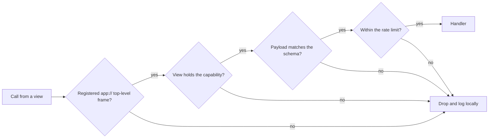

# IPC contracts

> **Status:** partly implemented. Contracts, router checks and the shell bridge exist. See [implementation status](#implementation-status).

Astela's user interface runs in sandboxed renderers, and its logic runs in the browser process. All traffic between them is designed to go through typed contracts that the browser process validates on every call. The decision record is ADR 0007 (IPC contracts and validation); see the [decision record index](../adr/README.md).

## Participants

| View type                    | Loaded from                                                                                                     | Preload              | Capability                                |
| ---------------------------- | --------------------------------------------------------------------------------------------------------------- | -------------------- | ----------------------------------------- |
| Shell view, one per window   | `app://shell`                                                                                                   | `preload/shell.ts`   | `shell`                                   |
| Overlay view, created lazily | an `app://` page                                                                                                | `preload/overlay.ts` | `overlay`                                 |
| Internal pages               | `app://settings`, `app://history`, `app://downloads`, `app://theme-editor`, `app://diagnostics`, `app://newtab` | `preload/page.ts`    | one per page, for example `page:settings` |
| Web tabs                     | the web                                                                                                         | none                 | none                                      |

The `data-service` utility process does not use renderer IPC. It talks to the browser process over a `MessagePort` (see [data.md](data.md)). [overview.md](overview.md) describes the process model as a whole.

## Contracts

Every channel is a contract in `shared/contracts`, declared with `defineIpc`. A contract names the channel, a request schema, a response schema and the capability a view needs to use it. The following example is illustrative:

```ts
import * as v from 'valibot';

export const inspectSetting = defineIpc({
  channel: 'settings.inspect',
  request: v.object({ key: v.string() }),
  response: v.object({ value: v.unknown(), source: v.string(), locked: v.boolean() }),
  capability: 'page:settings',
});
```

- **Valibot schemas.** Valibot validates without `eval` or `new Function` and therefore works under a strict Content Security Policy (as of October 2026). The same library validates settings, themes and feeds.
- **One definition everywhere.** Contracts live in `shared/`, which is pure TypeScript, so the browser process, the preloads and the UI import the same definitions.
- **Generated client.** The typed client used by the renderers will be generated from the contracts, so a view cannot call a channel with a payload of the wrong type.

### Capabilities

Every view type has a fixed set of capabilities, and every contract requires one capability. The shell and the overlay each have their own, and each internal page gets a capability of its own, so the settings page reaches only the channels the settings page needs. Web tabs have no capabilities.

## Router checks

In the browser process, `IpcRouter` is designed to register handlers with `handle(contract, handler)` and to run every incoming call through a middleware chain built with `use(middleware)`. The checks run in this order:

1. **Sender frame.** `event.senderFrame` must belong to a registered shell, overlay or internal view, its origin must be `app://…`, and it must be the top-level frame.
2. **Capability.** The sending view must hold the capability that the contract requires.
3. **Schema.** The payload must match the contract's request schema.
4. **Rate limit.** The call must stay within the channel's rate limit.

A call that fails any check will be dropped and logged locally, and the handler never sees it. Nothing is reported to a remote service.



## Preload bridges

- **One preload per view type:** `shell.ts`, `overlay.ts` and `page.ts` in `app/src/preload/`. Each exposes only `invoke(channel, payload)` and `subscribe(event)`, and only for the channels its view may use. No renderer gets a generic `ipcRenderer`.
- **Isolation:** the shell, the overlay and the internal pages run sandboxed, with `contextIsolation` and without Node integration.
- **Size:** the preload has a budget of 20 KB (see [performance.md](performance.md)).
- **Web tabs** get no preload and no bridge. Feature scripts, such as the reader view, run only on demand in an isolated world. The one planned exception is the content blocker (M2), which uses its own frame preload for cosmetic filtering.

Web tabs also cannot navigate to, embed or load `app://` pages. That guard belongs to the kernel and cannot be disabled (see [modules.md](modules.md)).

## No synchronous IPC

- Astela uses no synchronous IPC. Every call is asynchronous, so no renderer ever sits blocked waiting for the browser process.
- State flows from the browser process to the UI as a snapshot followed by patches. Patches are batched per frame, so a burst of changes reaches the UI as one update per frame.
- The shell renders from the merged settings snapshot, so values set by policy do not visibly change after the first paint (see [settings-policy-theme.md](settings-policy-theme.md)).
- Blocking work, such as SQLite queries and hashing, runs in utility processes, never on the main thread.

## Testing

- **Fuzzing:** property-based tests with fast-check will flood every contract with invalid payloads.
- **Integration:** the IPC router, including the fuzzing, will be tested on every pull request on all three operating systems.
- **Security:** dedicated tests will check the `webPreferences` of every created `WebContents`, the Content Security Policy of the `app://` pages and the navigation locks of the shell.

[testing.md](testing.md) describes the test levels, and [security.md](security.md) the wider security model.

## Implementation status

Implemented for the shell and the internal pages:

- **Contracts** (`app/src/shared/ipc/`): `defineRequest` and `defineEvent` with Valibot schemas and a capability per channel.
- **Router** (`app/src/platform/electron/ipc-gate.ts`, `ipc-router.ts`): every message passes the checks above in order (registered sender, main frame, origin, capability, schema, then a token-bucket rate limit). Rejected messages are logged locally and never reach a handler.
- **Bridges** (`app/src/preload/`): the shell bridge exposes only `invoke` and `on` for its allow-listed channels; the page bridge is scoped by a capability given on its command line.
- **State:** the shell receives one state snapshot per change, batched within 16 ms.
- **Settings page:** the capability `page:settings` with `settings.getAll`, `settings.set` and the event `settings.changed` (`app/src/shared/ipc/settings-contracts.ts`). The page bridge offers `on` for the events of the page's own scope; the browser process sends an event only to views that have its capability.
- **Appearance:** every view of the browser's own UI has the capability `appearance`; its preload, not the page, receives `appearance.changed` with the style sheet of design tokens.
- **New tab page:** the capability `page:newtab` with `newtab.getState`, which names the search engine, and `newtab.navigate`, which opens a search or an address in the page's own tab (`app/src/shared/ipc/newtab-contracts.ts`).

Not implemented yet: the overlay bridge, property-based tests of every contract, and the typed client generated from the contracts.
