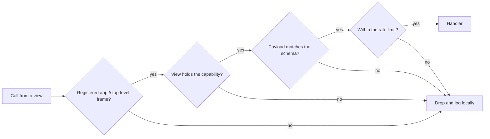

# IPC contracts

> **Status:** partly implemented. Contracts, router checks and the shell bridge exist. See [implementation status](#implementation-status).

Astela's user interface runs in sandboxed renderers, and its logic runs in the browser process. All traffic between them is designed to go through typed contracts that the browser process validates on every call. The decision record is ADR 0007 (IPC contracts and validation); see the [decision record index](../adr/README.md).

## Participants

| View type                    | Loaded from                                                                                                     | Preload                                    | Capability                                |
| ---------------------------- | --------------------------------------------------------------------------------------------------------------- | ------------------------------------------ | ----------------------------------------- |
| Shell view, one per window   | `app://shell`                                                                                                   | `preload/shell.ts`                         | `shell`                                   |
| Overlay view, created lazily | `app://overlay`                                                                                                 | `preload/page.ts` with the scope `overlay` | `overlay`                                 |
| Internal pages               | `app://settings`, `app://history`, `app://downloads`, `app://theme-editor`, `app://diagnostics`, `app://newtab` | `preload/page.ts`                          | one per page, for example `page:settings` |
| Web tabs                     | the web                                                                                                         | none                                       | none                                      |

The `data-service` utility process does not use renderer IPC. It talks to the browser process over a `MessagePort` (see [data.md](data.md)). [overview.md](overview.md) describes the process model as a whole.

## Contracts

Every channel is a contract in `shared/contracts`, declared with `defineIpc`. A contract names the channel, a request schema, a response schema and the capability a view needs to use it. The following example is illustrative:

```ts
import * as v from 'valibot';

export const inspectSetting = defineIpc({
  channel: 'settings.inspect',
  request: v.object({ key: v.string() }),
  response: v.object({ value: v.unknown(), source: v.string(), locked: v.boolean() }),
  capability: 'page:settings',
});
```

- **Valibot schemas.** Valibot validates without `eval` or `new Function` and therefore works under a strict Content Security Policy (as of October 2026). The same library validates settings, themes and feeds.
- **One definition everywhere.** Contracts live in `shared/`, which is pure TypeScript, so the browser process, the preloads and the UI import the same definitions.
- **Generated client.** The typed client used by the renderers will be generated from the contracts, so a view cannot call a channel with a payload of the wrong type.

### Capabilities

Every view type has a fixed set of capabilities, and every contract requires one capability. The shell and the overlay each have their own, and each internal page gets a capability of its own, so the settings page reaches only the channels the settings page needs. Web tabs have no capabilities.

## Router checks

In the browser process, `IpcRouter` is designed to register handlers with `handle(contract, handler)` and to run every incoming call through a middleware chain built with `use(middleware)`. The checks run in this order:

1. **Sender frame.** `event.senderFrame` must belong to a registered shell, overlay or internal view, its origin must be `app://…`, and it must be the top-level frame.
2. **Capability.** The sending view must hold the capability that the contract requires.
3. **Schema.** The payload must match the contract's request schema.
4. **Rate limit.** The call must stay within the channel's rate limit.

A call that fails any check will be dropped and logged locally, and the handler never sees it. Nothing is reported to a remote service.

Channels that the first window does not need, such as the shell's find in page, browser menu and popovers, are registered with `handleLater(channels, register)`. Their contracts and handlers are in a chunk of their own that loads with the first request on any of them; that request waits for the chunk, and every request passes the same checks as above. A test checks that these channels are exactly the ones that the chunk handles.



## Preload bridges

- **One preload per view type:** `shell.ts` and `page.ts` in `app/src/preload/`; the overlay uses `page.ts` with its own scope. Each exposes only `invoke(channel, payload)` and `subscribe(event)`, and only for the channels its view may use. No renderer gets a generic `ipcRenderer`.
- **Isolation:** the shell, the overlay and the internal pages run sandboxed, with `contextIsolation` and without Node integration.
- **Size:** the preload has a budget of 20 KB (see [performance.md](performance.md)).
- **Web tabs** get no preload and no bridge. The browser's own scripts for pages, such as the reader view's, run in an isolated world of their own, world 1002, and give their answer through Electron's call, which the browser process checks against a valibot schema; no channel leads from them to the browser. The media script of picture in picture runs the same way in the main frame, and in a frame of another site in that frame's own world, through `WebFrameMain.executeJavaScript`; its reports pass `MediaReportSchema`. The reader view checks the page of the active tab by itself once its main frame has loaded ([ADR 0057](../adr/0057-reader-view-and-picture-in-picture-in-isolated-worlds.md)). The one planned exception is the content blocker (M2), which uses its own frame preload for cosmetic filtering.

Web tabs also cannot navigate to, embed or load `app://` pages. That guard belongs to the kernel and cannot be disabled (see [modules.md](modules.md)).

## No synchronous IPC

- Astela uses no synchronous IPC. Every call is asynchronous, so no renderer ever sits blocked waiting for the browser process.
- State flows from the browser process to the UI as a snapshot followed by patches. Patches are batched per frame, so a burst of changes reaches the UI as one update per frame.
- The shell renders from the merged settings snapshot, so values set by policy do not visibly change after the first paint (see [settings-policy-theme.md](settings-policy-theme.md)).
- Blocking work, such as SQLite queries and hashing, runs in utility processes, never on the main thread.

## Testing

- **Fuzzing:** property-based tests with fast-check will flood every contract with invalid payloads.
- **Integration:** the IPC router, including the fuzzing, will be tested on every pull request on all three operating systems.
- **Security:** dedicated tests will check the `webPreferences` of every created `WebContents`, the Content Security Policy of the `app://` pages and the navigation locks of the shell.

[testing.md](testing.md) describes the test levels, and [security.md](security.md) the wider security model.

## Implementation status

Implemented for the shell and the internal pages:

- **Contracts** (`app/src/shared/ipc/`): `defineRequest` and `defineEvent` with Valibot schemas and a capability per channel.
- **Router** (`app/src/platform/electron/ipc-gate.ts`, `ipc-router.ts`): every message passes the checks above in order (registered sender, main frame, origin, capability, schema, then a token-bucket rate limit). Rejected messages are logged locally and never reach a handler.
- **Bridges** (`app/src/preload/`): the shell bridge exposes only `invoke` and `on` for its allow-listed channels; the page bridge is scoped by a capability given on its command line.
- **State:** the shell receives one state snapshot per change, batched within 16 ms. Each tab in it tells, among other things, whether it sleeps (`TabView.sleeping`): it has no page loaded and loads once it is shown. Putting a tab to sleep needs no channel of its own, as the menu of a tab is native and runs in the browser process. Each tab also tells which side of a split view it is (`TabView.split`), and the state the split view of the active tab with the share of its left side (`ShellState.split`); the shell sends `tabs.resizeSplit` while people move the divider, at most once per frame and every 8 ms, well within the 240 per second of the channel, with `done` once they let it go, and the channel loads with the later handlers of the shell ([ADR 0054](../adr/0054-split-view-with-two-tabs-side-by-side.md)). The questions of sites and the sign-in prompt in the overlay name the side of their page in a split view (`pane`), over which the overlay's page shows them. Each tab of a group of tabs carries its group (`TabView.group`, with id, name, color and whether it is collapsed), from which the shell draws the chips; the shell asks `groups.toggle` to show or hide the tabs of a group, with `keyboard` when Enter or Space on the chip asked, which keeps the focus on the chip, and `groups.openEditor` to open its popover at the chip, and names the group that a dragged tab joins in `tabs.move` (`group`, `null` for none) while the window has groups. The browser asks the shell with the event `shell.editGroup` to open the popover of a group once its chip shows, such as after **Add to new group** in the menu of a tab; `tabs.openMenu` says whether the keyboard opened that menu, and the event passes it on, so that the popover gives the focus back to the shell as one that the keyboard opened. The event and the two requests of groups load with the later handlers of the shell. The state names the workspace that the window shows and every workspace of the profile (`ShellState.workspace` and `workspaces`, `null` and empty in private windows, in popups and while workspaces are off); the shell asks `workspaces.open` to open their list at its button, with its rectangle, and `workspaces.moveTab` with a tab and a workspace when a dragged tab is dropped on the target of a workspace, both with the later handlers of the shell, and the browser asks the shell with the command `workspaces.open` of `shell.command` to open the list for its shortcut ([ADR 0055](../adr/0055-tab-groups-and-workspaces-in-the-tab-model.md)). Each tab also tells whether its page has an article and whether the reader view shows it (`TabView.reader`: `none`, `available` or `open`); the button of the reader view asks `shell.toggleReader`, which takes no payload and runs the command `reader.toggle` of the window as its key does, with the later handlers of the shell. Each tab tells as well whether a video of its page plays or shows in picture in picture (`TabView.pictureInPicture`: `none`, `available` or `open`); the button of picture in picture asks `shell.togglePictureInPicture`, which takes no payload either and runs the command `media.pictureInPicture` ([ADR 0057](../adr/0057-reader-view-and-picture-in-picture-in-isolated-worlds.md)). The state tells the shell where the toolbar is and whether the rows at the top hide (`ShellState.layout`: `toolbar`, `own-row` or `tab-row`, and `hiding`, `null` while they always show, or whether they show, what stays of them, an `edge` or a `title` row, and its height); the shell tells the browser whether the pointer is over the rows, whether a control of the rows has its focus for the keys, a field or a control that the keyboard focused, and whether it drew the rows hidden a frame ago with `shell.holdTopRows` (at most 30 per second, with the later handlers of the shell), and only when one of them changed; the browser sends the state at once when the rows change, and lays the page above the shell only once the shell drew them hidden ([ADR 0058](../adr/0058-layout-presets-and-top-rows-that-hide.md)). `ShellState.popover` has the kind `group` for the popover of a group of tabs, which holds such rows open like every popover. The chip of the connection of a web page asks `shell.openSiteInfo` with its rectangle and whether the keyboard opened it, with the later handlers of the shell, and `ShellState.popover` has the kind `site` while site information is open ([ADR 0059](../adr/0059-site-information-with-checked-certificates.md)).
- **Settings page:** the capability `page:settings` with `settings.getAll`, `settings.set`, `settings.applyLayoutPreset`, which names one of the four layout presets and sets its four settings at once, leaving out and naming those that a mandatory policy sets (at most 5 per second, [ADR 0058](../adr/0058-layout-presets-and-top-rows-that-hide.md)), `settings.getBlockerStatus`, the event `settings.changed` and the event `settings.reveal`, which names the row or section that a page shows the address of already, such as after a link of the browser or a choice in the command palette, so that it shows it again and gives it the focus; the page only looks the name up (`app/src/shared/ipc/settings-contracts.ts`). The page bridge offers `on` for the events of the page's own scope; the browser process sends an event only to views that have its capability.
- **Web frames:** only the content blocker's frame preload talks to the browser process, with `blocker.frame` (synchronous, once per frame) and `blocker.elements`; both answer only frames of web sessions, with filter rules for the frame's own address ([ADR 0028](../adr/0028-content-blocker-rules-through-a-frame-preload.md)).
- **Appearance:** every view of the browser's own UI has the capability `appearance`; its preload, not the page, receives `appearance.changed` with the style sheet of design tokens.
- **Overlay:** the capability `overlay` with `overlay.get` and the event `overlay.changed` for what it shows, `overlay.close`, `overlay.exited`, with which the page tells that a popover that closed has left, so the view leaves the window, `overlay.chooseMenuItem` and `overlay.openSubmenu` with the place of an item of a menu, whose command, bookmark or folder the browser process finds in the menu that it sent, `overlay.saveBookmark` and `overlay.removeBookmark` for the popover of the star, which accept only the bookmark that the popover shows and a folder that it offers, `overlay.editGroup` with a new name, while people type it, or color, and `overlay.groupAction` with a new tab in the group, ending it or closing its tabs, which act only on the group whose popover the sending page shows, `overlay.switchWorkspace`, `overlay.saveWorkspace` with the name, icon and color of a new workspace or of one of the list, and whether a new one keeps its cookies apart, which answers the id of the workspace or `null`, `overlay.moveWorkspace` with its new place and `overlay.deleteWorkspace`, which act only for the window whose list of workspaces the sending page shows, `overlay.chooseSuggestion` with the place of a suggestion of the address bar that was clicked, which switches to the tab that it names or opens its address in the active tab, the content blocker's `overlay.toggleSiteBlocking`, which the shield's popover and site information share, and `overlay.openBlockerSettings`, the requests of site information: `overlay.setSitePermission` and `overlay.resetSitePermissions` for a decided permission of the site, `overlay.clearSiteData` (at most 2 per second), `overlay.restoreWarnings` for a certificate that was accepted or an insecure address that was opened (at most 2 per second), `overlay.reloadTab` (at most 2 per second), each with the number of the popover, which acts only while the overlay shows that popover and its tab still shows the same origin, and `overlay.openSiteSettings`, `overlay.answerPermission` with the answer to a site's question for permissions, which names the question it answers, `overlay.shareScreen` with the screen or window chosen for a site, `overlay.download` and `overlay.openDownloadsFolder` for the list of downloads, which open a finished download or its folder, `overlay.signIn` with the user name and password of the sign-in prompt, which the browser process never logs, and the requests of the command palette: `overlay.paletteQuery` asks for the open tabs, with whether each sleeps, its group and its workspace, bookmarks, visited pages and the target of the address bar that match a text (at most 60 per second), and the answer to the first request of an opening brings the keys typed before the palette was ready, which the page takes also when a later request answered first; `overlay.paletteChoose` names a place in one of the last four answers, `overlay.paletteRun` a command, which the browser process checks again, and `overlay.paletteSetting` the row of the settings to open; `overlay.favicon` gives the icon of a tab of a window of the same kind only (at most 250 per second), and the event `overlay.paletteShortcut` tells the palette that one of its shortcuts was pressed. The browser process never logs what was typed into the palette (`app/src/shared/ipc/overlay-contracts.ts`, [ADR 0034](../adr/0034-overlay-view-for-popovers-and-prompts.md), [ADR 0047](../adr/0047-address-suggestions-in-a-part-of-the-overlay.md), [ADR 0050](../adr/0050-browser-menus-and-popovers-in-the-overlay.md), [ADR 0052](../adr/0052-command-palette-and-tab-search-in-the-overlay.md), [ADR 0055](../adr/0055-tab-groups-and-workspaces-in-the-tab-model.md), [ADR 0059](../adr/0059-site-information-with-checked-certificates.md)).
- **New tab page:** the capability `page:newtab` with `newtab.getState`, which names the search engine, and `newtab.navigate`, which opens a search or an address in the page's own tab (`app/src/shared/ipc/newtab-contracts.ts`).

Not implemented yet: property-based tests of every contract and the typed client generated from the contracts.
