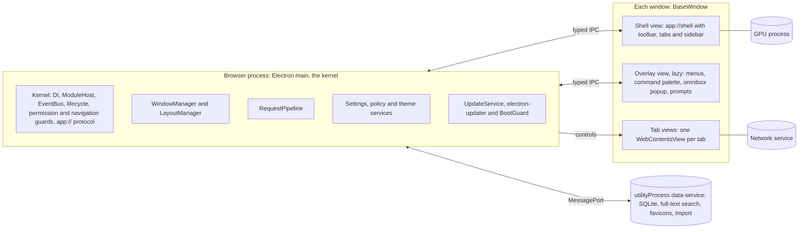
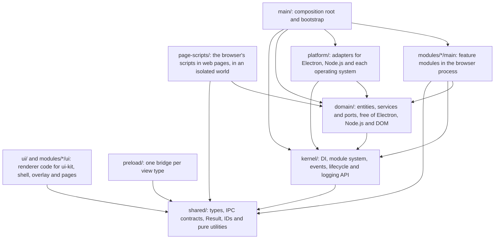
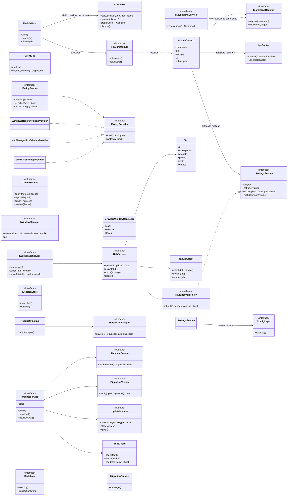
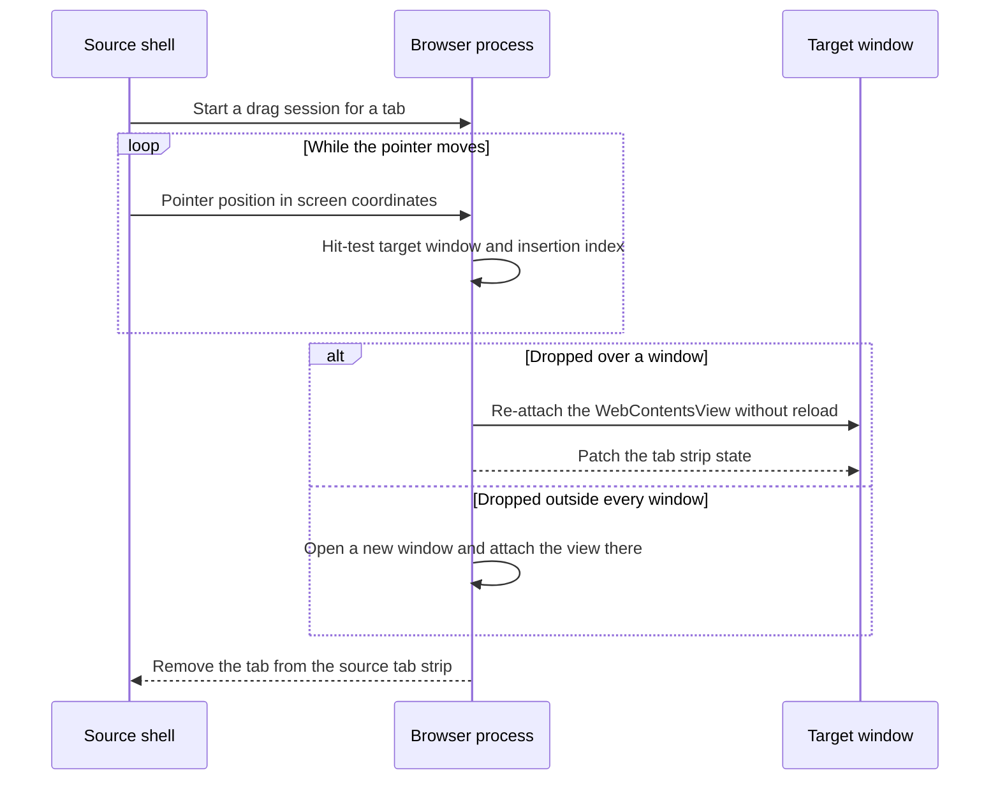

# Architecture overview

> **Status:** this page describes the target architecture of Astela. Windows with tabs, the browser's own pages, the data service, the content blocker, the overlay view, tab groups and workspaces exist; the module host is still design. See [implementation status](#implementation-status).

Astela is a desktop browser for Windows, macOS and Linux. It embeds Chromium through upstream Electron and is written in TypeScript. The browser process acts as a small kernel. Every feature is a module, every module beyond the core can be switched off, and a module that is off is never loaded. The [principles](principles.md) explain why the architecture looks the way it does.

## Key decisions

Each decision is recorded in an [architecture decision record](../adr/README.md).

| Topic                | Decision                                                                                                                                   | ADR  |
| -------------------- | ------------------------------------------------------------------------------------------------------------------------------------------ | ---- |
| Engine               | Upstream Electron, always on the latest stable major (45.x as of October 2026). Each new major is adopted within two to four weeks.        | 0002 |
| Web content          | `BaseWindow` with one `WebContentsView` per tab; no `<webview>` tag and no `BrowserView`.                                                  | 0002 |
| Language and build   | TypeScript in strict mode, limited to erasable syntax; Vite with electron-vite builds the main, preload and renderer code.                 | 0004 |
| UI                   | Class-based web components with Lit, written without decorators; trivial leaf elements are plain `HTMLElement` classes.                    | 0005 |
| Dependency injection | A custom typed container with constructor injection and scopes, without reflection.                                                        | 0006 |
| IPC                  | Typed contracts with Valibot schemas, validated on every call.                                                                             | 0007 |
| Internal pages       | A privileged `app://` scheme: the internal session serves it with `protocol.registerSource`, and every web session refuses it.             | 0008 |
| Storage              | `node:sqlite` in a `utilityProcess`, validated on every platform and architecture; a prebuilt native module stays the documented fallback. | 0009 |
| Modules              | A microkernel with lazily loaded feature modules.                                                                                          | 0010 |
| Updates              | electron-updater as the installation engine behind Astela's own Ed25519-signed update feed.                                                | 0014 |

## Process model

- **Browser process (Electron main):** the kernel. It owns the lifecycle, windows, tabs (`WebContentsView`), sessions and partitions, the network pipeline, settings, policies and updates. It stays lean: blocking work such as SQLite access, hashing and imports runs in a `utilityProcess`.
- **Shell view (one renderer per window):** the entire browser interface as class-based web components, loaded from the privileged scheme `app://shell`. It runs sandboxed with `contextIsolation` and a minimal preload that exposes a typed bridge, never a generic `ipcRenderer`.
- **Overlay view (lazy):** a transparent `WebContentsView` above the web content for menus, the command palette, omnibox suggestions and permission prompts. It solves the z-order problem that web views always sit above the shell's DOM. The overlay is created on first use, or when the pointer reaches the menu button or the button takes the focus, and attached to the view tree **only while something is open**, because views are neither click-through nor focus-neutral; a popover leaves with its motion before the view leaves the tree. When it closes, the browser process returns focus to the page, or to the shell after a popover that the keyboard opened there. Context menus, the menu of a tab and the menu bar of macOS are native (`Menu.popup()`, [ADR 0050](../adr/0050-browser-menus-and-popovers-in-the-overlay.md)).
- **Tab views:** web content, sandboxed, with site isolation and **without a preload**; the one exception is the content blocker's frame preload, which every web session registers for all its frames ([ADR 0028](../adr/0028-content-blocker-rules-through-a-frame-preload.md)); it also keeps pages from marking regions that move the window ([ADR 0048](../adr/0048-title-bar-drawn-by-the-browser.md)). The browser's own scripts for pages (`app/src/page-scripts`) run in an isolated world of their own, world 1002, which the page cannot reach: the reader view checks the page of the active tab once its main frame has loaded, and reads its article when people open the reader; picture in picture looks at the videos of a page and shows one in picture in picture for a click on the browser's button, in frames of other sites in the frame's own world, as Electron gives frames no isolated worlds ([ADR 0057](../adr/0057-reader-view-and-picture-in-picture-in-isolated-worlds.md)). Mouse gestures use input events in the browser process instead of scripts injected into the page.
- **Internal pages** (`app://settings`, `app://history`, `app://downloads`, `app://theme-editor`, `app://diagnostics`, `app://newtab`): regular tabs with a capability-based preload. Each page receives only the IPC channels it needs.
- **Data service (`utilityProcess`):** SQLite, full-text search, favicons and import. It starts lazily and talks to the browser process over a `MessagePort`. See [data](data.md).
- **Network service (Chromium's utility process):** it loads the web pages, and the browser's own pages depend on it too: Chromium asks it to read the headers of every response that does not come from the network, those of `app://` as well, and a navigation commits only once it answers. A service that went away took the answers that it owed with it, and Chromium starts a new one without asking again; one that hangs never answers. Either way the navigation would never end and its view would stay empty. So a main-frame navigation of the internal session that still waits for its first response after 10 s hands over to `app/src/platform/electron/network-service.ts`, which loads only then. The page loads again at once, as the service may have gone away before. Then the browser looks every 10 s and loads it again when another service runs than at the last look, or as soon as Chromium reports the service gone (`child-process-gone`, which Chromium does not send for every way a process ends). A service that has not answered such a page for 30 s, and did not change for 20 s, is ended, once in a run, so that Chromium starts a new one: on the macOS runners, healthy services answered within 13.2 s in 19,109 starts, and one that is only slow would be slow again. A view loads again at most four times before it shows a page, and each step is logged. Web pages are left as they are, so that no form is sent twice.
- **Updates:** electron-updater runs in the browser process with asynchronous I/O. Verifying the Ed25519 signature of the feed takes microseconds. See [updates](updates.md).

### Always-on guards

Some protections belong to the kernel, not to a module, so they can never be switched off: the permission handlers, the navigation and window guards, and the `app://` registration, each installed on **every** session. Even with every optional module disabled, or in safe mode, every sensitive request stays denied. Tests will cover both "module off, still denied" and "a web tab cannot open `app://settings`". See [security](security.md).

### IPC at a glance

- Every channel is a contract in `shared/contracts` with a request schema, a response schema and the capability allowed to use it.
- `IpcRouter` in the browser process checks, in this order: that the sender is one of Astela's own views (a registered shell, overlay or internal page, with an `app://` origin, in the top-level frame), that the view holds the required capability, that the payload matches the schema, and that the per-channel rate limit is respected. Anything invalid is dropped and logged locally.
- Each preload exposes only `invoke(channel, payload)` and `subscribe(event)`, and only for the channels its view type may use. A typed client is generated from the contracts.
- There is no synchronous IPC. State flows from the browser process to the UI as a snapshot followed by patches, batched once per frame.

See [IPC](ipc.md) for the full design.

## Layers and enforced boundaries

The source code is split into layers with a strict dependency direction. Paths are relative to `app/src/`.

Dependencies only follow the direction of the arrows; nothing points back up. `shared` is pure and imports nothing from the other layers, and `main/` is the only place where all parts are wired together.

Three mechanisms enforce these boundaries, so that a violation fails the build instead of waiting for a review:

1. **TypeScript project references.** Each layer is its own `composite` project: `shared`, `kernel`, `domain`, `platform`, `modules-main`, `modules-ui`, `preload`, `page-scripts`, `ui` and `main`. An import from a project that is not referenced fails to compile. Each project also restricts its `lib` and `types`: `domain`, `kernel` and `shared` see neither DOM nor Node.js types, and `ui`, `modules-ui`, `preload` and `page-scripts` see no Node.js types.
2. **dependency-cruiser rules.**
   - The layer direction shown above, with no cycles.
   - `electron` may only be imported in `platform/`, `main/` and `preload/`.
   - `modules/A` may import from `modules/B` only through `modules/B/api`.
   - `ui/` never imports code that runs in the browser process.
   - `page-scripts/` imports only `domain/` and `shared/`, so a script for web pages carries no code of the browser process or of Node.js ([ADR 0057](../adr/0057-reader-view-and-picture-in-picture-in-isolated-worlds.md)).
   - Each layer has a list of forbidden packages.
3. **Lint rules** such as `no-restricted-imports`, which give fast feedback in the editor.

### Modules at a glance

Every feature is a module under `modules/<id>/`. Its `manifest.ts` holds static metadata: it is tiny, purely declarative and always bundled. The `main/` and `ui/` code lives in separate chunks that are loaded with `import()` only when the module is active, and other modules reach it only through its `api/` folder. The core modules `windows`, `tabs`, `navigation`, `settings`, `policy`, `themes`, `i18n`, `session`, `updates` and `diagnostics` are always active; everything else can be switched off by setting or policy. A test will verify that the chunks of disabled modules are never requested. See [modules](modules.md).

## Central classes and interfaces

| Type                                                                                        | Kind             | Responsibility                                                                                                                                                |
| ------------------------------------------------------------------------------------------- | ---------------- | ------------------------------------------------------------------------------------------------------------------------------------------------------------- |
| `Container`                                                                                 | Class            | Typed dependency injection: registers providers with a lifetime, resolves tokens, creates child containers and disposes what it created.                      |
| `ModuleHost`                                                                                | Class            | Reads the module manifests, resolves the active set from policy, settings and dependencies, and starts, enables and disables modules.                         |
| `IFeatureModule`                                                                            | Interface        | The contract every feature module implements: `activate(ctx)` and `deactivate()`.                                                                             |
| `ModuleContext`                                                                             | Class            | What a module receives on activation. Commands, IPC handlers, settings listeners and UI slots registered through it are disposables in `subscriptions`.       |
| `EventBus`                                                                                  | Class            | Typed domain events such as `TabActivated` and `SettingChanged`.                                                                                              |
| `ISettingsService`, `SettingsService`                                                       | Interface, class | Reads, writes and inspects settings across ordered configuration layers and reports changes. `inspect(key)` returns the value, its source and its lock state. |
| `ConfigLayer`                                                                               | Interface        | One layer of the settings resolution order, such as defaults, user settings or a mandatory policy.                                                            |
| `IPolicyService`                                                                            | Interface        | The merged policy state: values, locks and change events.                                                                                                     |
| `IPolicyProvider`                                                                           | Interface        | Loads policies from one operating system source and watches it for changes.                                                                                   |
| `WindowsRegistryPolicyProvider`, `MacManagedPrefsPolicyProvider`, `LinuxJsonPolicyProvider` | Classes          | The policy providers for the Windows registry, macOS managed preferences and Linux JSON files.                                                                |
| `IThemeService`                                                                             | Interface        | Applies a theme to a scope (global or a workspace), imports, exports and previews themes.                                                                     |
| `IWindowManager`                                                                            | Interface        | Opens windows and keeps track of them.                                                                                                                        |
| `BrowserWindowController`                                                                   | Class            | One window: a `BaseWindow` with its shell view, lazy overlay view and content layout.                                                                         |
| `ITabService`                                                                               | Interface        | Opens, activates, moves and puts tabs to sleep.                                                                                                               |
| `Tab`                                                                                       | Class            | The domain entity for a tab: ID, workspace, group, pinned flag, lifecycle state and navigation entries. A tab is not a view.                                  |
| `TabViewHost`                                                                               | Class            | Creates a tab's `WebContentsView` when needed, attaches it to a window, detaches it and destroys it.                                                          |
| `ITabLifecyclePolicy`                                                                       | Interface        | A strategy that decides whether a tab may sleep in a given context.                                                                                           |
| `IWorkspaceService`                                                                         | Interface        | Creates workspaces, switches the workspace a window shows and moves tabs between workspaces.                                                                  |
| `ISessionStore`                                                                             | Interface        | Takes session snapshots and restores them.                                                                                                                    |
| `ICommandRegistry`                                                                          | Interface        | Registers and executes commands.                                                                                                                              |
| `IKeybindingService`                                                                        | Interface        | Resolves keyboard input to a command.                                                                                                                         |
| `IpcRouter`                                                                                 | Class            | Binds handlers to IPC contracts and runs the middleware chain in front of them.                                                                               |
| `RequestPipeline`, `IRequestInterceptor`                                                    | Class, interface | An ordered chain of network request interceptors; each returns a decision for a request.                                                                      |
| `IUpdateService`                                                                            | Interface        | Checks for, downloads and installs updates, and exposes the updater state.                                                                                    |
| `IManifestSource`                                                                           | Interface        | Fetches the signed manifest for an update channel, from the default feed or a mirror.                                                                         |
| `ISignatureVerifier`                                                                        | Interface        | Verifies Ed25519 signatures on the feed index and manifests.                                                                                                  |
| `IUpdateInstaller`                                                                          | Interface        | Stages and applies an update for one installation type, such as NSIS or AppImage.                                                                             |
| `BootGuard`                                                                                 | Class            | Counts start attempts after an update and decides whether to roll back to the previous version.                                                               |
| `IDatabase`                                                                                 | Interface        | Runs SQL statements and transactions in the data service.                                                                                                     |
| `MigrationRunner`                                                                           | Class            | Runs data migrations transactionally up to a target schema version.                                                                                           |

## Design patterns

Patterns are used where they solve a concrete problem, not for decoration.

| Pattern                 | Use                                                                                                                                                             |
| ----------------------- | --------------------------------------------------------------------------------------------------------------------------------------------------------------- |
| Microkernel and plugins | The kernel plus feature modules (see [modules](modules.md)).                                                                                                    |
| Dependency injection    | A custom typed container with static `inject` lists and no reflection, about 200 lines of code. Scopes: app, window and module.                                 |
| Ports and adapters      | `domain` defines ports such as `IFileSystem`, `IKeyStore`, `IRegistry` and `IClock`; `platform` implements them. Tests use in-memory adapters.                  |
| Command                 | `CommandRegistry`: shortcuts, the command palette, menus and the toolbar trigger the same commands. Undo for "reopen closed tab".                               |
| Observer and event bus  | Typed domain events such as `TabActivated` and `SettingChanged`.                                                                                                |
| Chain of responsibility | `RequestPipeline` (policy URL filter → HTTPS upgrade → blocker → permissions), IPC middleware (sender check → schema validation → rate limit), settings layers. |
| Strategy                | Tab sleep policies, update installers per package format, policy providers per operating system, search engines.                                                |
| State machine           | Tab lifecycle (`unloaded → loading → live → sleeping → crashed`) and updater (`idle → checking → downloading → staged → applying`).                             |
| Memento                 | Session snapshots of windows, workspaces, tabs and navigation entries.                                                                                          |
| Composite               | The split view layout tree and tab groups.                                                                                                                      |
| Mediator                | `LayoutManager` coordinates shell insets, the tab bar position, the sidebar and the content bounds.                                                             |
| Repository              | `HistoryRepository`, `BookmarkRepository` and others on top of `IDatabase`.                                                                                     |
| Facade                  | `platform/electron/*` wraps the Electron APIs, so that Electron upgrades stay local.                                                                            |

## Windows, tabs and workspaces

- **Window:** a `BrowserWindowController` combines a `BaseWindow`, the shell view, the lazy overlay view and a `ContentLayout`. The `LayoutManager` computes all view bounds from the tab bar position (top, bottom, left or right), the sidebar, the density, compact mode and full screen; the shell reports its insets.
- **Layouts:** from 0.1.0-beta.7, the toolbar can share the row of the tabs at the top (`toolbar.placement`), and that row can hide until it is needed (`toolbar.autoHide`); four presets set these, the place of the tabs and the density at once ([ADR 0058](../adr/0058-layout-presets-and-top-rows-that-hide.md)). While the rows hide, the page lies below an edge or a title row of the shell; while they show, the browser moves the opaque shell above the pages and cuts it to the height of its rows, so the page neither moves nor changes its size (`app/src/platform/electron/hiding-rows.ts`, which loads only while the setting is on). The pure rules are in `app/src/domain/windows/top-rows.ts` and `title-bar.ts`.
- **Tab and view:** a tab is a domain entity, not a view. `TabViewHost` creates the `WebContentsView` only when the tab is activated and destroys it when the tab goes to sleep. The navigation entries are kept (`navigationHistory`), so a page comes back with its history when it wakes up.
- **Workspace:** a name, icon, color and partition (shared or isolated), and a theme of its own later. The definitions are the profile setting `workspaces.list`; the tabs, groups and pinned tabs of each workspace belong to a window, which keeps them in a tab strip per workspace and shows one workspace at a time. Switching swaps the visible views; tabs that are already live stay alive, so the switch is instant and nothing reloads. `Alt+1` to `Alt+9` on Windows and Linux and `Control+1` to `Control+9` on macOS switch; what a page opens, a popup included, stays in its workspace, and private windows and popups have none ([ADR 0055](../adr/0055-tab-groups-and-workspaces-in-the-tab-model.md)).
- **Tab groups** (name, color, collapsible) and **pinned tabs** belong to their workspace. Each tab of a group carries its group, and the rules of groups load with a window's first group as a strip of their own (`GroupedTabStrip`, `app/src/domain/tabs/tab-groups.ts`).
- **Partitions:** `persist:default` for shared workspaces, `persist:ws-<id>` for each isolated workspace, hardened like `persist:default`, chosen when the workspace is made and never changed, and an in-memory partition for private windows. A tab that moves into a workspace with another partition reloads there with its back and forward entries, without page state; a deleted workspace's folder goes at the next start.

### Drag and drop

- **Within a window:** pointer events in the shell handle the drag. A tab dragged onto the button of the workspaces shows a target for each other workspace next to it, found by its rectangle; a drop moves the tab there (`workspaces.moveTab`).
- **Between windows:** the browser process runs a drag session. The source shell reports screen coordinates through pointer capture, and the browser process finds the target window and insertion index with a hit test.
- **Moving without reload:** the `WebContentsView` is re-attached to the target window without a reload, so page state such as the scroll position and form content survives.
- **Tear-off:** dropping a tab outside every window opens a new window.
- **Isolated workspaces:** moving a tab into a workspace with a different partition reloads it in the target partition, and the UI indicates this unobtrusively.

### Wayland

Wayland does not let applications position their windows. A torn-off window is therefore placed by the compositor rather than at the pointer position, and a setting to run under X11 instead is planned. The overlay view is transparent on every system; its rendering under Wayland is not yet covered by the tests, which run under X11.

## Further reading

- [Principles](principles.md): the eight principles, target groups and non-goals.
- [Modules](modules.md): the module system, manifests and lazy loading.
- [IPC](ipc.md): contracts, validation and state flow between processes.
- [Data](data.md): storage, atomic writes, backups and migrations.
- [Settings, policies and themes](settings-policy-theme.md): one schema for the UI, policies and documentation.
- [Design system](design-system.md): tokens, density, typography, icons and motion.
- [Enterprise](enterprise.md): policy sources, MSI, proxy, certificates, SSO and diagnostics.
- [Updates](updates.md): the signed feed, per-format update strategies and rollback.
- [Security](security.md): Electron hardening, permissions, network protections and the supply chain.
- [Performance](performance.md): budgets, techniques and the measurement method.
- [Testing](testing.md): test levels, tools and rules.
- [Validation results](validation.md): measurements from the experiments that tested the riskiest assumptions.
- [Architecture decision records](../adr/README.md): every significant decision and its reasoning.
- [Roadmap](../roadmap.md): milestones, priorities and the M1 delivery order.

## Implementation status

The first browser window works end to end:

- **Process model:** one `BaseWindow` per window with a shell view (`app://shell`) and one `WebContentsView` per tab, created when the tab first becomes active. The tab service of a window keeps the order of its tabs, the active tab and the tabs that closed lately in a tab strip (`app/src/domain/tabs/tab-strip.ts`), where a tab moves as a unit: the tab alone, or the two tabs of a split view. A popup and a private window close with their last tab, as in other browsers, so the private session can end with the last private tab; a regular window gets a new tab page instead (`onLastClosed` of `TabService`). While downloads of private windows run, the last private window asks before it closes, which would cancel them (`holdsPrivateClose`, in `app/src/main/downloads.ts`), and keeps a new tab page if people keep it. With its first [group of tabs](../user/tab-groups.md), a window's strip becomes a strip with groups (`app/src/domain/tabs/tab-groups.ts`, [ADR 0055](../adr/0055-tab-groups-and-workspaces-in-the-tab-model.md)), which keeps the tabs of a group together, never groups pinned tabs, moves a collapsed group as a whole and puts the tabs that a grouped tab opens in its group; it loads with the menu of a tab, and before the first window only for a session with groups. The window attaches the views of the tabs that its content area shows, which are the active tab and, in a [split view](../adr/0054-split-view-with-two-tabs-side-by-side.md), the other tab of its pair, in one place, always below the overlay, and lays them out in the area that the shell leaves them, side by side with the geometry of `app/src/shared/split-view.ts`, or over the whole window while the page of the active tab is in full screen. The active tab is the side of a split view with the focus: a click into the other side makes its tab the active one through the `focus` event of its web contents, and no tab view, nor the shell's view, takes the focus by itself (`focusOnNavigation: false`). Tab past the end of the shell goes on to the page that the content area shows and Tab past the end of a page, which the page's preload reports, back to the shell; F6 and Shift+F6 go between the address bar and the page, and the tab strip moves its focus with the arrow keys ([ADR 0065](../adr/0065-keyboard-focus-between-the-toolbar-and-the-page.md)). A window appears at once in the background color of the theme and the shell paints into it; a hidden window would load the shell at a lower priority. Web content and the browser's own pages use separate sessions. New tabs open on the new tab page (`app://newtab/`), an internal page in a view of the internal session with a search field for the chosen search engine. When a tab switches between a web page and an internal page, its view is replaced and the old view's history is kept, so Back from the first web page returns to the new tab page ([ADR 0026](../adr/0026-internal-pages-share-tabs-with-web-pages.md)). The first start of a profile opens the [setup guide](../user/setup-guide.md) (`app://setup`) instead of the new tab page, once per profile. The menu button at the end of the toolbar, F10 and Alt alone on Windows and Linux open the browser menu, a menu of the overlay with new tabs and windows, closing the window (`window.close`, `Ctrl+Shift+W`, `Command+Shift+W`), a zoom row, the history, downloads and bookmarks, the page tools, the settings, About and Quit, which a pure model makes from the window commands (`app/src/domain/menus/browser-menu.ts`, [ADR 0050](../adr/0050-browser-menus-and-popovers-in-the-overlay.md)); the [settings page](../user/settings.md) (`app://settings`) opens in the tab that shows it already, in place of a new tab page, or in a new tab.
- **Shell:** the tab strip at the top or bottom or as a list on the left or right, whose tabs show the icon of their page, a turning ring while it loads and a button that mutes a tab that plays sound, and open, close and move by dragging with animations of the transform only, where a pure module tells where a dragged tab lands and which group it joins, and keeps the two tabs of a split view together (`app/src/ui/shell/strip-items.ts`) ([tabs](../user/tabs.md)), the chips of groups of tabs with a line in the group's color along their tabs, which show or hide the tabs of a group and open its popover in the overlay ([tab groups](../user/tab-groups.md)), the divider of a split view, an ARIA separator that the pointer and the keys move, with a line above the side with the focus and the problems of each side's page in its side, back, forward and reload buttons, an address bar that tells URLs from searches, shows the host of a page first and how secure its connection is, with a chip that opens site information for web pages (`app/src/shared/connection.ts`), keeps what was typed for each tab and suggests open tabs, bookmarks and visited pages in a part of the overlay ([address bar](../user/address-bar.md), [ADR 0047](../adr/0047-address-suggestions-in-a-part-of-the-overlay.md)), which holds the list and the room that its shadow needs, 24 px beside it and 32 px below it, where a press closes the list and gives the focus to the page (`app/src/main/suggestions.ts`), the bookmark star, whose popover in the overlay names, moves or removes the bookmark of the page, the content blocker's shield, the menu button and the optional bookmarks bar, whose folders open as menus of the overlay (`app/src/ui/shell/`). A quiet sign in the address bar shows while the page of the active tab asked for protected video or music that the browser cannot play, until it navigates or plays media; the tabs with the sign come with the event `shell.protectedMedia` from `app/src/main/protected-media.ts`, which loads with the first such page ([ADR 0064](../adr/0064-web-features-that-electron-shows-no-ui-for.md)). A button whose popover is open has `aria-expanded` and looks pressed, from the field `popover` of the shell's state. The [keyboard shortcuts](../user/keyboard-shortcuts.md) for tabs, history, reload, the address bar and the [page tools](../user/page-tools.md) follow the conventions of each system and work in the shell and in web content (`app/src/platform/electron/shortcuts.ts`). As in other browsers, letter shortcuts on layouts for other scripts use the key that carries the letter on an English keyboard, and Ctrl or Command without Alt on a key of the digits counts as that digit, whatever the layout types there, such as `Ctrl+1` on French or Czech layouts; only a minus sign stays one, so French zooms out on its 6 key ([other layouts](../user/keyboard-shortcuts.md#other-layouts-and-input-methods)). The browser process sees each key before the page, so no default shortcut is a key that edits text. The commands of the menus, such as duplicating or muting a tab, About and Quit, are window commands as well, without a default shortcut, and one pure rule tells which commands can run in a window now (`app/src/domain/commands/availability.ts`), which the menus and the command palette follow; `Ctrl+K` and `Ctrl+Shift+A` (`Command+K` and `Command+Shift+A`) open the palette and tab search while the setting `commandPalette.enabled` is on, and `Ctrl+Shift+S` (`Control+Command+S`) opens or ends a split view while `splitView.enabled` is on. The back and forward buttons of a mouse work over the page and over the toolbar.
- **Page tools:** the find bar below the toolbar looks for text with Chromium's `findInPage` and shows the number of matches. The zoom of a page applies to its whole site, also in other tabs, and is kept in the setting `zoom.sites`; the address bar shows it while it is not 100 %. When a page shows an element in full screen, its view covers the window. Printing, saving, also as PDF with Electron's `printToPDF` on the paper of the system's region, `app.getSystemLocale()` as for the regional formats, or else of the language of the menus (`app/src/domain/page-tools/paper-size.ts`: US Letter in the regions that use it, A4 elsewhere, `preferCSSPageSize`; Chrome takes it from its own locale, which the two languages of Astela cannot tell), the source and the developer tools load with their first use (`app/src/main/page-tools.ts`); they work on web pages, not on the browser's own pages, and the policy `DeveloperToolsAvailability` can keep the developer tools closed. Chromium's PDF viewer shows PDF documents in the tab.
- **Reader view:** once the main frame of the active tab's web page has loaded, the browser runs the script of the reader view (`app/src/page-scripts/reader.ts`, built into `out/preload/page-scripts/reader.cjs`) in the isolated world 1002 and marks the tab when the page has an article. On request, the script reads the article with the extractor of `app/src/domain/reader/`, the browser process checks it against the schema of an article, and `app/src/main/reader.ts`, which loads with the first web page that has loaded in the active tab, writes it as a `data:` document without scripts in the colors and fonts of the browser and shows it in a view of the page's session that covers the tab (`cover()` and `uncover()` of the window). The page stays loaded and unchanged under it, and a tab that sleeps while its reader view shows gets it back once it has woken ([ADR 0057](../adr/0057-reader-view-and-picture-in-picture-in-isolated-worlds.md)).
- **Picture in picture:** `app/src/main/picture-in-picture.ts` loads with the first video that plays or pauses while picture in picture is on, once it is turned on, with its command or the context menu of a video, or before a tab goes to sleep. It runs the media script (`app/src/page-scripts/media.ts`, built into `out/preload/page-scripts/media.cjs`) in the main frame, in world 1002, and in the frames of other sites, checks the reports against `MediaReportSchema` and gives each tab its state (`Tab.pictureInPicture`): after media events of the active tab, when a tab shows, when a window gets the focus, once a page that loaded meanwhile has loaded, for each click and before a tab sleeps. It asks no page whose main frame loads, as Electron would hold the script back until every frame has loaded and then run it in whatever page has loaded. A click on the button next to the address bar, the browser menu, the command palette or the context menu of a video runs the script of the frame of the chosen video with Electron's activation flag, as `requestPictureInPicture()` needs one, at once and only in the document that the browser chose ([ADR 0057](../adr/0057-reader-view-and-picture-in-picture-in-isolated-worlds.md)). A tab with a video in picture in picture does not sleep, also while picture in picture is off, and Document Picture-in-Picture is turned off: `bootstrap.ts` turns off Blink's feature `DocumentPictureInPictureAPI` before the first page starts, and the window guard refuses what Electron cannot place, such as a window of the disposition `other`.
- **Composition root:** `app/src/main/bootstrap.ts` wires the first services by hand. It moves onto the dependency injection container and the module host with the first feature module.
- **Context menus:** native menus (`Menu.popup()`) for links, images, videos, audio, selected text, text fields and the page itself, and for the address bar; see the [user guide](../user/context-menus.md). Save image, video and audio as downloads the file with `downloadURL` and marks its address, so that its download asks where to save it, also while downloads are saved without a question (`app/src/main/save-as.ts`, matched on the first address of the download's chain). A pure function in `app/src/domain/context-menu/` describes each menu from Chromium's context menu parameters, the texts and the platform, and has unit tests. `app/src/main/context-menu.ts` shows the description and carries out the commands on the view that was clicked; it loads with the first context menu, not before the first window. The texts come from the browser process's own catalogs in `app/src/main/i18n/`, which ship the same languages as the shell, follow the system language like the shell and share its translator in `app/src/shared/i18n/`. They mark an access key for Windows and Linux, one per item of a menu, and macOS gets English in title case. The menu of a tab (`app/src/main/tab-menu.ts`) uses the same catalogs, names the tabs below a tab instead of those to its right when the tab strip is at a side, opens, swaps and ends split views, puts tabs in groups and takes them out, and its items do nothing for a tab that closed while the menu was open. Tabs opened from a menu take the same path and the same http and https rule as tabs that pages open; tabs opened in the background line up after the page in the order they were opened. The menus of web pages end with Inspect, which opens the developer tools at the clicked element, unless the policy `DeveloperToolsAvailability` keeps them closed. The View menu of the macOS menu bar runs the same commands as the keys, so it acts on the page and follows the policy too, after it closed a popover that covers the window. The browser menu takes the texts of the same catalogs, with an access key per item that a unit test checks in English and German, but it is no native menu: the overlay shows it, and a unit test keeps `Menu.popup()` to the context menus and the menu of a tab.
- **Data service:** a utility process owns `profile.db` with the history and the bookmarks and runs the import from other browsers; it starts with the first data access: the first web page, the bookmarks bar, the history or bookmarks page, or the list of other browsers in the settings and the setup guide. See [data storage](data.md) and [ADR 0029](../adr/0029-import-from-other-browsers-in-the-data-service.md).
- **Windows and popups:** what a script of a page opens keeps its opener: a tab next to the page, or for a popup with a size a window of its own; `Ctrl+N` opens a new window ([ADR 0040](../adr/0040-tabs-and-popups-that-keep-their-opener.md)). The view that takes over the page that Chromium made names the preferences of a web view, as Electron would otherwise reset the page's preferences to its own defaults ([ADR 0064](../adr/0064-web-features-that-electron-shows-no-ui-for.md)). Private windows (`Ctrl+Shift+N`) load web pages in a session in memory and keep no history or session ([ADR 0041](../adr/0041-private-windows-with-a-session-in-memory.md)).
- **Workspaces:** a window keeps the tabs of each workspace in a strip of its own and shows one of them; with its second workspace, its strip becomes the strips of the workspaces (`app/src/domain/tabs/workspace-strips.ts`), whose shown strip answers for the window and whose other strips keep their tabs alive, updated and closable while hidden. The button at the start of the tab strip opens the list of the workspaces in the overlay (`app/src/ui/overlay/workspace-list.ts`), where they are made, renamed, moved and deleted; `app/src/main/workspaces.ts`, which loads with the first use, switches the workspace, runs the commands and the shortcuts `Alt+1` to `Alt+9` (`Control+1` to `Control+9`), moves tabs from the menu of a tab or by drag, deletes workspaces with their partition data and follows the setting `workspaces.enabled` and the policy `WorkspacesEnabled`, which merge the strips while it is off; a change of them loads that code at once for a window with tabs in another workspace, and its first use brings every window in line. Tab search and the suggestions of the address bar show a tab of another workspace with its workspace, and load the strips for it only then (`app/src/domain/tabs/show-tab.ts`). Each view of a web page takes the partition of its tab's workspace: `persist:ws-<id>` for an isolated workspace, hardened like every web session. What a page opens stays in its workspace ([workspaces](../user/workspaces.md), [ADR 0055](../adr/0055-tab-groups-and-workspaces-in-the-tab-model.md)).
- **Session:** the windows, their tabs with their back and forward history, their groups and their workspaces, where the windows were, whether they were in full screen and the order in which they were used are kept in `session.json` and restored at the next start, and also after a crash, whatever the start setting says, unless a mandatory policy sets it (`session.json.running`). A restored tab that does not show yet is dormant: it keeps its address and its history (`app/src/domain/tabs/tab-history.ts`) and gets its view, of the kind of the page that it shows, when it is first shown, with its history restored by `navigationHistory.restore()` at the scroll position and with the form values of its page ([ADR 0053](../adr/0053-sleeping-tabs-and-an-exact-session.md)). The format stays at version 1 and each optional field is read on its own, so that 0.1.0-beta.6 reads the sessions of later versions with every tab ([data storage](data.md#implementation-status)).
- **Sleeping tabs:** a tab goes to sleep from its menu, or by itself after the time of the setting `tabs.sleepAfter` while `tabs.sleep` is on; its view closes and it becomes a dormant tab like a restored one, with its title, icon and history, and wakes when it is shown, navigated or reloaded ([ADR 0053](../adr/0053-sleeping-tabs-and-an-exact-session.md), [tabs](../user/tabs.md#sleeping-tabs)). A tab stays awake while the window shows it, while it plays sound and, by itself, while it is pinned; `app/src/platform/electron/tab-activity.ts`, which loads with the code for web pages before the first web page, sees what else keeps a page awake: a camera, a microphone or the screen that it was granted, until it navigates, its downloads, media that play, also without sound, its developer tools, a video in picture in picture as picture in picture last saw it, and the pages that it opened or that opened it. By itself, the browser also leaves pages that people typed into since they loaded, which the window sees from the keys that reach a page; it never asks a page with `beforeunload`, as Electron would give the page a user gesture for that. A tab whose video shows in picture in picture stays awake, and the menu of a tab and the scheduler let picture in picture look at the page first, as a page can start picture in picture itself (`beforeSleep`). The scheduler loads after the first shell (`app/src/main/tab-sleep.ts`): a pure policy (`InactivityPolicy` in `app/src/domain/tabs/tab-sleep.ts`) tells which tabs of each window are due and when the next one is, and it arms one timer for that, none while no tab can become due, and looks at the tabs at most once a second. The shell fades the icon of a dormant tab and gives it a description for screen readers (`TabView.sleeping`).
- **Content blocker:** one request pipeline per web session blocks requests with the filter engine, and a frame preload applies element hiding rules and scriptlets in every frame ([ADR 0027](../adr/0027-blocker-with-the-default-lists-of-ublock-origin.md), [ADR 0028](../adr/0028-content-blocker-rules-through-a-frame-preload.md)).
- **Overlay:** a transparent view above the tabs shows popovers and prompts: the browser menu and the menus of the folders of the bookmarks bar, the popover of the bookmark star, the content blocker's popover, the list of downloads, the sign-in prompt, the questions of sites for permissions and for security keys, the popover of the sign of protected media and the screen picker; it is part of the window only while it is open ([ADR 0034](../adr/0034-overlay-view-for-popovers-and-prompts.md)). `WindowOverlay.open(content, options)` takes what the content needs: the button of the shell that it belongs to, where the focus goes back, how it handles Escape and shortcuts, and whether a site's question may take its place. Popovers enter and leave with `--motion-enter` and `--motion-exit`, and the view leaves the window when the page says that a popover has left, or after 250 ms; what leaves is the element that showed, and menus and the popover of the star have elements of their own (`app/src/ui/overlay/`, [ADR 0050](../adr/0050-browser-menus-and-popovers-in-the-overlay.md)). The [command palette](../user/command-palette.md) and tab search are content of the overlay as well (`app/src/ui/overlay/command-palette.ts`, `app/src/main/palette.ts`, [ADR 0052](../adr/0052-command-palette-and-tab-search-in-the-overlay.md)): the page finds the commands and the rows of the settings in every shipped language, and the browser process answers `overlay.paletteQuery` with the open tabs of the windows of the same kind, bookmarks, visited pages and the target of the address bar (`app/src/domain/palette/results.ts`); the window holds the keys typed after the palette's shortcut until the palette asks for them (`app/src/domain/palette/held-typing.ts`). A site's question and the sign-in prompt take the palette's two shortcuts and do nothing with them (`questionKeys` in `app/src/main/overlays.ts`), so the palette never takes their place. Site information opens at the chip of the connection in the address bar (`app/src/ui/overlay/site-info.ts`, `app/src/main/site-info.ts`, [ADR 0059](../adr/0059-site-information-with-checked-certificates.md)): the connection, the certificate that Chromium checked, the permissions of the site in the store of the window's kind, its cookies and data, which it deletes in the window's session, and the switch of the content blocker, which it shares with the shield (`app/src/main/site-blocking.ts`); its requests name the popover and act only while the tab still shows its site. A page that shows an element in full screen or takes the mouse pointer gets a notice at the top of the pages for 4 s, the top of the window in full screen, that names the site of its document's origin, shortened at its start, and Escape, or only Escape for an origin without a site (`app/src/main/page-notices.ts`, which loads with the first of them): it lies in a part of the window of the size that its page measured (`overlay.noticeSize`), takes neither the focus nor keys (`passive`), so a click on it gives the focus back to the page, stays when the window changes its size (`place`), gives way to a question and waits for one that is open (`whenIdle`), and goes when the page leaves full screen or navigates. A site that waits for a security key on Linux or macOS gets a question with the site and Cancel, and the choice of an account when the key holds several, one per frame and at most eight per page (`app/src/main/webauthn-prompt.ts`, which loads with the first request); the sign of protected media opens a popover that says why and links to the user guide (`app/src/main/protected-media.ts`) ([ADR 0064](../adr/0064-web-features-that-electron-shows-no-ui-for.md)).
- **Downloads:** web sessions save downloads in the downloads folder without a question, under a name that is free there (`app/src/main/bootstrap.ts`); the list of downloads, kept in `profile.db`, its panel in the overlay and the progress of the downloads button load with the first download (`app/src/main/downloads.ts`, [ADR 0039](../adr/0039-downloads-without-a-question-and-a-list-in-the-profile.md)).
- **Site permissions:** web sessions ask before a site uses the camera, the microphone, the location, notifications or the clipboard, keep the answer per origin in the setting `permissions.sites`, or for private windows in the memory of the private session, and list it on the settings page; site information changes and resets them for the site of the page; the prompts load with the first question (`app/src/main/site-permissions.ts`, `app/src/main/permission-prompt.ts`, [ADR 0038](../adr/0038-site-permissions-asked-in-the-overlay.md)). On Linux, where Chromium cannot find the location without a key of Google's location service, sites get no at once (`canLocate`); the Storage Access API of a frame of another site is answered from the blocking of third-party cookies, without a question (`storageAccessOpen`, [ADR 0044](../adr/0044-third-party-cookies-blocked-by-chromium.md)).
- **Certificates:** every web session has a verify function that keeps Chromium's result and hands what Chromium checked to a log per session and host, which loads with the code for the requests of web pages (`app/src/platform/electron/certificate-verify.ts`, `certificate-log.ts`, [ADR 0059](../adr/0059-site-information-with-checked-certificates.md)).
- **Links from other apps:** links on the command line, from a second start and from `open-url` events open in tabs; the Windows installer registers the browser for web links ([ADR 0030](../adr/0030-default-browser-and-links-from-other-apps.md)).
- **Network service:** when Chromium's network service goes away or does not answer while a window loads, the shell, the overlay and the browser's own pages of that window load again once a service answers, instead of staying empty. On the macOS runners the first network service of about one start in 2,000 never came up: in 9 of 10 such starts Chromium replaced it 16 to 57 s after the start, and in one it had not answered when the browser was stopped 82 s after the start; the browser now ends such a service after 30 s.
- **Windows that macOS keeps:** AppKit keeps the windows of an app for its next start, per bundle ID and outside the profile, although it cannot reopen the browser's windows. After the browser ended abnormally during a start, AppKit would ask in an alert, before any window, whether to reopen them, and hold back `ready` until someone answered. So the main script registers the user default `ApplePersistenceIgnoreState` before the start (`app/src/main/window-restoration.ts`); AppKit reads it when it handles the launch in its run loop, which Electron starts only after the main script has loaded. AppKit then ignores the state it kept and keeps new state in a temporary folder, whose path it logs at each start. The default is registered, not written, so a value set with `defaults` wins.

Not implemented yet: themes per workspace, and drag and drop between windows.
