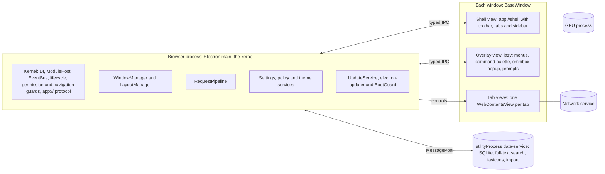
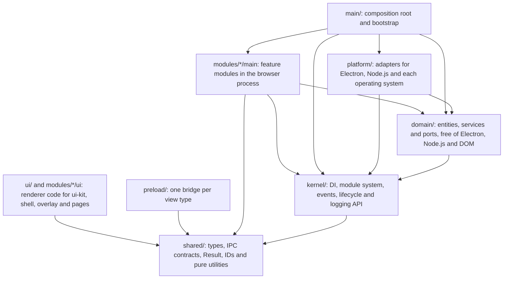
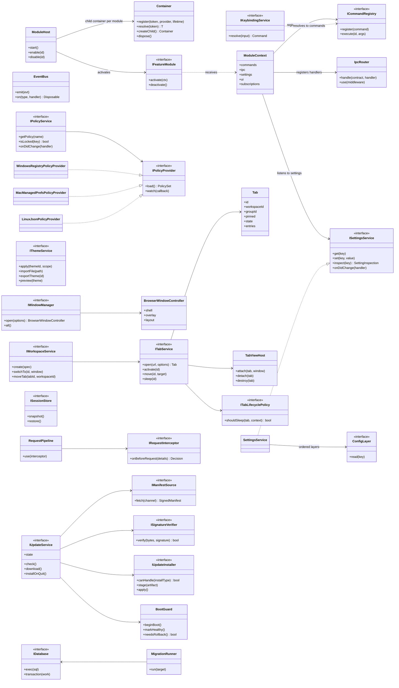
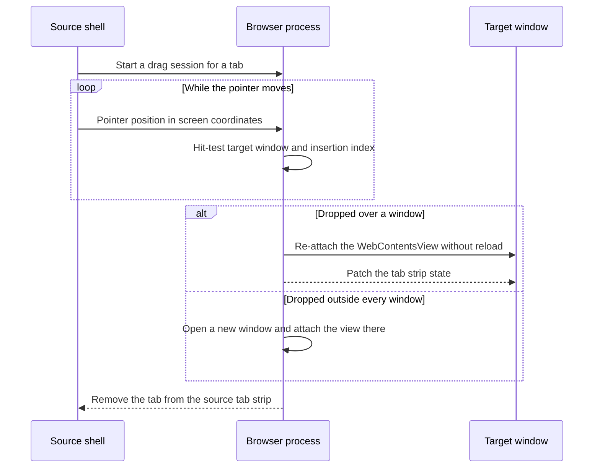

# Architecture overview

> **Status:** this page describes the target architecture of Astela. A first window with tabs and an address bar exists; everything else here is design. See [implementation status](#implementation-status).

Astela is a desktop browser for Windows, macOS and Linux. It embeds Chromium through upstream Electron and is written in TypeScript. The browser process acts as a small kernel. Every feature is a module, every module beyond the core can be switched off, and a module that is off is never loaded. The [principles](principles.md) explain why the architecture looks the way it does.

## Key decisions

Each decision is recorded in an [architecture decision record](../adr/README.md).

| Topic                | Decision                                                                                                                                   | ADR  |
| -------------------- | ------------------------------------------------------------------------------------------------------------------------------------------ | ---- |
| Engine               | Upstream Electron, always on the latest stable major (45.x as of October 2026). Each new major is adopted within two to four weeks.        | 0002 |
| Web content          | `BaseWindow` with one `WebContentsView` per tab; no `<webview>` tag and no `BrowserView`.                                                  | 0002 |
| Language and build   | TypeScript in strict mode, limited to erasable syntax; Vite with electron-vite builds the main, preload and renderer code.                 | 0004 |
| UI                   | Class-based web components with Lit, written without decorators; trivial leaf elements are plain `HTMLElement` classes.                    | 0005 |
| Dependency injection | A custom typed container with constructor injection and scopes, without reflection.                                                        | 0006 |
| IPC                  | Typed contracts with Valibot schemas, validated on every call.                                                                             | 0007 |
| Internal pages       | A privileged `app://` scheme: the internal session serves it with `protocol.registerSource`, and every web session refuses it.             | 0008 |
| Storage              | `node:sqlite` in a `utilityProcess`, validated on every platform and architecture; a prebuilt native module stays the documented fallback. | 0009 |
| Modules              | A microkernel with lazily loaded feature modules.                                                                                          | 0010 |
| Updates              | electron-updater as the installation engine behind Astela's own Ed25519-signed update feed.                                                | 0014 |

## Process model

- **Browser process (Electron main):** the kernel. It owns the lifecycle, windows, tabs (`WebContentsView`), sessions and partitions, the network pipeline, settings, policies and updates. It stays lean: blocking work such as SQLite access, hashing and imports runs in a `utilityProcess`.
- **Shell view (one renderer per window):** the entire browser interface as class-based web components, loaded from the privileged scheme `app://shell`. It runs sandboxed with `contextIsolation` and a minimal preload that exposes a typed bridge, never a generic `ipcRenderer`.
- **Overlay view (lazy):** a transparent `WebContentsView` above the web content for menus, the command palette, omnibox suggestions and permission prompts. It solves the z-order problem that web views always sit above the shell's DOM. The overlay is created on first use and attached to the view tree **only while something is open**, because views are neither click-through nor focus-neutral. When it closes, the browser process returns focus to the page. Context menus are native (`Menu.popup()`).
- **Tab views:** web content, sandboxed, with site isolation and **without a preload**; the one planned exception is the content blocker's frame preload (M2, see [IPC](ipc.md)). Feature scripts, such as the reader view, run only on demand in an isolated world. Mouse gestures use input events in the browser process instead of scripts injected into the page.
- **Internal pages** (`app://settings`, `app://history`, `app://downloads`, `app://theme-editor`, `app://diagnostics`, `app://newtab`): regular tabs with a capability-based preload. Each page receives only the IPC channels it needs.
- **Data service (`utilityProcess`):** SQLite, full-text search, favicons and import. It starts lazily and talks to the browser process over a `MessagePort`. See [data](data.md).
- **Updates:** electron-updater runs in the browser process with asynchronous I/O. Verifying the Ed25519 signature of the feed takes microseconds. See [updates](updates.md).

### Always-on guards

Some protections belong to the kernel, not to a module, so they can never be switched off: the permission handlers, the navigation and window guards, and the `app://` registration, each installed on **every** session. Even with every optional module disabled, or in safe mode, every sensitive request stays denied. Tests will cover both "module off, still denied" and "a web tab cannot open `app://settings`". See [security](security.md).

### IPC at a glance

- Every channel is a contract in `shared/contracts` with a request schema, a response schema and the capability allowed to use it.
- `IpcRouter` in the browser process checks, in this order: that the sender is one of Astela's own views (a registered shell, overlay or internal page, with an `app://` origin, in the top-level frame), that the view holds the required capability, that the payload matches the schema, and that the per-channel rate limit is respected. Anything invalid is dropped and logged locally.
- Each preload exposes only `invoke(channel, payload)` and `subscribe(event)`, and only for the channels its view type may use. A typed client is generated from the contracts.
- There is no synchronous IPC. State flows from the browser process to the UI as a snapshot followed by patches, batched once per frame.

See [IPC](ipc.md) for the full design.

## Layers and enforced boundaries

The source code is split into layers with a strict dependency direction. Paths are relative to `app/src/`.

Dependencies only follow the direction of the arrows; nothing points back up. `shared` is pure and imports nothing from the other layers, and `main/` is the only place where all parts are wired together.

Three mechanisms enforce these boundaries, so that a violation fails the build instead of waiting for a review:

1. **TypeScript project references.** Each layer is its own `composite` project: `shared`, `kernel`, `domain`, `platform`, `modules-main`, `modules-ui`, `preload`, `ui` and `main`. An import from a project that is not referenced fails to compile. Each project also restricts its `lib` and `types`: `domain`, `kernel` and `shared` see neither DOM nor Node.js types, and `ui`, `modules-ui` and `preload` see no Node.js types.
2. **dependency-cruiser rules.**
   - The layer direction shown above, with no cycles.
   - `electron` may only be imported in `platform/`, `main/` and `preload/`.
   - `modules/A` may import from `modules/B` only through `modules/B/api`.
   - `ui/` never imports code that runs in the browser process.
   - Each layer has a list of forbidden packages.
3. **Lint rules** such as `no-restricted-imports`, which give fast feedback in the editor.

### Modules at a glance

Every feature is a module under `modules/<id>/`. Its `manifest.ts` holds static metadata: it is tiny, purely declarative and always bundled. The `main/` and `ui/` code lives in separate chunks that are loaded with `import()` only when the module is active, and other modules reach it only through its `api/` folder. The core modules `windows`, `tabs`, `navigation`, `settings`, `policy`, `themes`, `i18n`, `session`, `updates` and `diagnostics` are always active; everything else can be switched off by setting or policy. A test will verify that the chunks of disabled modules are never requested. See [modules](modules.md).

## Central classes and interfaces

| Type                                                                                        | Kind             | Responsibility                                                                                                                                                |
| ------------------------------------------------------------------------------------------- | ---------------- | ------------------------------------------------------------------------------------------------------------------------------------------------------------- |
| `Container`                                                                                 | Class            | Typed dependency injection: registers providers with a lifetime, resolves tokens, creates child containers and disposes what it created.                      |
| `ModuleHost`                                                                                | Class            | Reads the module manifests, resolves the active set from policy, settings and dependencies, and starts, enables and disables modules.                         |
| `IFeatureModule`                                                                            | Interface        | The contract every feature module implements: `activate(ctx)` and `deactivate()`.                                                                             |
| `ModuleContext`                                                                             | Class            | What a module receives on activation. Commands, IPC handlers, settings listeners and UI slots registered through it are disposables in `subscriptions`.       |
| `EventBus`                                                                                  | Class            | Typed domain events such as `TabActivated` and `SettingChanged`.                                                                                              |
| `ISettingsService`, `SettingsService`                                                       | Interface, class | Reads, writes and inspects settings across ordered configuration layers and reports changes. `inspect(key)` returns the value, its source and its lock state. |
| `ConfigLayer`                                                                               | Interface        | One layer of the settings resolution order, such as defaults, user settings or a mandatory policy.                                                            |
| `IPolicyService`                                                                            | Interface        | The merged policy state: values, locks and change events.                                                                                                     |
| `IPolicyProvider`                                                                           | Interface        | Loads policies from one operating system source and watches it for changes.                                                                                   |
| `WindowsRegistryPolicyProvider`, `MacManagedPrefsPolicyProvider`, `LinuxJsonPolicyProvider` | Classes          | The policy providers for the Windows registry, macOS managed preferences and Linux JSON files.                                                                |
| `IThemeService`                                                                             | Interface        | Applies a theme to a scope (global or a workspace), imports, exports and previews themes.                                                                     |
| `IWindowManager`                                                                            | Interface        | Opens windows and keeps track of them.                                                                                                                        |
| `BrowserWindowController`                                                                   | Class            | One window: a `BaseWindow` with its shell view, lazy overlay view and content layout.                                                                         |
| `ITabService`                                                                               | Interface        | Opens, activates, moves and puts tabs to sleep.                                                                                                               |
| `Tab`                                                                                       | Class            | The domain entity for a tab: ID, workspace, group, pinned flag, lifecycle state and navigation entries. A tab is not a view.                                  |
| `TabViewHost`                                                                               | Class            | Creates a tab's `WebContentsView` when needed, attaches it to a window, detaches it and destroys it.                                                          |
| `ITabLifecyclePolicy`                                                                       | Interface        | A strategy that decides whether a tab may sleep in a given context.                                                                                           |
| `IWorkspaceService`                                                                         | Interface        | Creates workspaces, switches the workspace a window shows and moves tabs between workspaces.                                                                  |
| `ISessionStore`                                                                             | Interface        | Takes session snapshots and restores them.                                                                                                                    |
| `ICommandRegistry`                                                                          | Interface        | Registers and executes commands.                                                                                                                              |
| `IKeybindingService`                                                                        | Interface        | Resolves keyboard input to a command.                                                                                                                         |
| `IpcRouter`                                                                                 | Class            | Binds handlers to IPC contracts and runs the middleware chain in front of them.                                                                               |
| `RequestPipeline`, `IRequestInterceptor`                                                    | Class, interface | An ordered chain of network request interceptors; each returns a decision for a request.                                                                      |
| `IUpdateService`                                                                            | Interface        | Checks for, downloads and installs updates, and exposes the updater state.                                                                                    |
| `IManifestSource`                                                                           | Interface        | Fetches the signed manifest for an update channel, from the default feed or a mirror.                                                                         |
| `ISignatureVerifier`                                                                        | Interface        | Verifies Ed25519 signatures on the feed index and manifests.                                                                                                  |
| `IUpdateInstaller`                                                                          | Interface        | Stages and applies an update for one installation type, such as NSIS or AppImage.                                                                             |
| `BootGuard`                                                                                 | Class            | Counts start attempts after an update and decides whether to roll back to the previous version.                                                               |
| `IDatabase`                                                                                 | Interface        | Runs SQL statements and transactions in the data service.                                                                                                     |
| `MigrationRunner`                                                                           | Class            | Runs data migrations transactionally up to a target schema version.                                                                                           |

## Design patterns

Patterns are used where they solve a concrete problem, not for decoration.

| Pattern                 | Use                                                                                                                                                             |
| ----------------------- | --------------------------------------------------------------------------------------------------------------------------------------------------------------- |
| Microkernel and plugins | The kernel plus feature modules (see [modules](modules.md)).                                                                                                    |
| Dependency injection    | A custom typed container with static `inject` lists and no reflection, about 200 lines of code. Scopes: app, window and module.                                 |
| Ports and adapters      | `domain` defines ports such as `IFileSystem`, `IKeyStore`, `IRegistry` and `IClock`; `platform` implements them. Tests use in-memory adapters.                  |
| Command                 | `CommandRegistry`: shortcuts, the command palette, menus and the toolbar trigger the same commands. Undo for "reopen closed tab".                               |
| Observer and event bus  | Typed domain events such as `TabActivated` and `SettingChanged`.                                                                                                |
| Chain of responsibility | `RequestPipeline` (policy URL filter → HTTPS upgrade → blocker → permissions), IPC middleware (sender check → schema validation → rate limit), settings layers. |
| Strategy                | Tab sleep policies, update installers per package format, policy providers per operating system, search engines.                                                |
| State machine           | Tab lifecycle (`unloaded → loading → live → sleeping → crashed`) and updater (`idle → checking → downloading → staged → applying`).                             |
| Memento                 | Session snapshots of windows, workspaces, tabs and navigation entries.                                                                                          |
| Composite               | The split view layout tree and tab groups.                                                                                                                      |
| Mediator                | `LayoutManager` coordinates shell insets, the tab bar position, the sidebar and the content bounds.                                                             |
| Repository              | `HistoryRepository`, `BookmarkRepository` and others on top of `IDatabase`.                                                                                     |
| Facade                  | `platform/electron/*` wraps the Electron APIs, so that Electron upgrades stay local.                                                                            |

## Windows, tabs and workspaces

- **Window:** a `BrowserWindowController` combines a `BaseWindow`, the shell view, the lazy overlay view and a `ContentLayout`. The `LayoutManager` computes all view bounds from the tab bar position (top, bottom, left or right), the sidebar, the density, compact mode and full screen; the shell reports its insets.
- **Tab and view:** a tab is a domain entity, not a view. `TabViewHost` creates the `WebContentsView` only when the tab is activated and destroys it when the tab goes to sleep. The navigation entries are kept (`navigationHistory`), so a page comes back with its history when it wakes up.
- **Workspace:** a name, icon, color, theme, partition (shared or isolated), tabs, groups and pinned tabs. A window shows one workspace at a time. Switching swaps the visible views; tabs that are already live stay alive, so the switch is instant and nothing reloads.
- **Tab groups** (name, color, collapsible) and **pinned tabs** belong to their workspace.
- **Partitions:** `persist:default` for shared workspaces, `persist:ws-<id>` for each isolated workspace, and an in-memory partition for private windows.

### Drag and drop

- **Within a window:** pointer events in the shell handle the drag.
- **Between windows and onto workspace icons:** the browser process runs a drag session. The source shell reports screen coordinates through pointer capture, and the browser process finds the target window and insertion index with a hit test.
- **Moving without reload:** the `WebContentsView` is re-attached to the target window without a reload, so page state such as the scroll position and form content survives.
- **Tear-off:** dropping a tab outside every window opens a new window.
- **Isolated workspaces:** moving a tab into a workspace with a different partition reloads it in the target partition, and the UI indicates this unobtrusively.

### Wayland

Wayland does not let applications position their windows. A torn-off window is therefore placed by the compositor rather than at the pointer position, and a setting to run under X11 instead is planned. Transparent views render black on Wayland, so the overlay view is opaque there.

## Further reading

- [Principles](principles.md): the eight principles, target groups and non-goals.
- [Modules](modules.md): the module system, manifests and lazy loading.
- [IPC](ipc.md): contracts, validation and state flow between processes.
- [Data](data.md): storage, atomic writes, backups and migrations.
- [Settings, policies and themes](settings-policy-theme.md): one schema for the UI, policies and documentation.
- [Design system](design-system.md): tokens, density, typography, icons and motion.
- [Enterprise](enterprise.md): policy sources, MSI, proxy, certificates, SSO and diagnostics.
- [Updates](updates.md): the signed feed, per-format update strategies and rollback.
- [Security](security.md): Electron hardening, permissions, network protections and the supply chain.
- [Performance](performance.md): budgets, techniques and the measurement method.
- [Testing](testing.md): test levels, tools and rules.
- [Validation results](validation.md): measurements from the experiments that tested the riskiest assumptions.
- [Architecture decision records](../adr/README.md): every significant decision and its reasoning.
- [Roadmap](../roadmap.md): milestones, priorities and the M1 delivery order.

## Implementation status

The first browser window works end to end:

- **Process model:** one `BaseWindow` per window with a shell view (`app://shell`) and one `WebContentsView` per tab, created when the tab first becomes active. A window appears at once in the background color of the theme and the shell paints into it; a hidden window would load the shell at a lower priority. Web content and the browser's own pages use separate sessions. New tabs open on the new tab page (`app://newtab/`), an internal page in a view of the internal session with a search field for the chosen search engine. When a tab switches between a web page and an internal page, its view is replaced and the old view's history is kept, so Back from the first web page returns to the new tab page ([ADR 0026](../adr/0026-internal-pages-share-tabs-with-web-pages.md)). The first start of a profile opens the [setup guide](../user/setup-guide.md) (`app://setup`) instead of the new tab page, once per profile. The menu button at the end of the toolbar opens the browser menu, a native menu with New tab and Settings; the [settings page](../user/settings.md) (`app://settings`) opens in the tab that shows it already, in place of a new tab page, or in a new tab.
- **Shell:** tab strip on top, back, forward and reload buttons, and an address bar that tells URLs from searches (`app/src/ui/shell/`). The [keyboard shortcuts](../user/keyboard-shortcuts.md) for tabs, history, reload and the address bar follow the conventions of each system and work in the shell and in web content (`app/src/platform/electron/shortcuts.ts`). The browser process sees each key before the page, so no default shortcut is a key that edits text. The back and forward buttons of a mouse work over the page and over the toolbar.
- **Composition root:** `app/src/main/bootstrap.ts` wires the first services by hand. It moves onto the dependency injection container and the module host with the first feature module.
- **Context menus:** native menus (`Menu.popup()`) for links, images, selected text, text fields and the page itself, and for the address bar; see the [user guide](../user/context-menus.md). A pure function in `app/src/domain/context-menu/` describes each menu from Chromium's context menu parameters, the texts and the platform, and has unit tests. `app/src/main/context-menu.ts` shows the description and carries out the commands on the view that was clicked; it loads with the first context menu, not before the first window. The texts come from the browser process's own catalogs in `app/src/main/i18n/`, which ship the same languages as the shell, follow the system language like the shell and share its translator in `app/src/shared/i18n/`. They mark an access key for Windows and Linux, and macOS gets English in title case. Tabs opened from a menu take the same path and the same http and https rule as tabs that pages open; tabs opened in the background line up after the page in the order they were opened. The menus have no Inspect item, because no setting or policy for the developer tools (`DeveloperToolsAvailability`) exists yet; on macOS, the View menu of the menu bar already offers Toggle Developer Tools.

Not implemented yet: the overlay view, workspaces, tab groups, drag and drop, and the data-service process.
