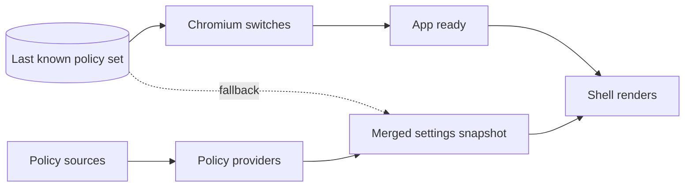

# Settings, policies and themes

> **Status:** partly implemented. The settings and policy core and the policy providers exist; the rest of this page is design. See [implementation status](#implementation-status).

Settings, policies and themes share one idea: everything a user, an administrator or a theme author can change is declared once, as data with a schema, and everything else is derived from that declaration. The settings page, the policy templates, the JSON Schemas and the reference documentation are generated from it, never written by hand.

The decisions behind this design are recorded in ADR 0011 (settings schema as single source), ADR 0012 (policy providers per OS) and ADR 0013 (theme system and design tokens). See the [decision records](../adr/README.md).

Related documents:

- [Modules](modules.md): how modules contribute settings and policies.
- [Data](data.md): how settings and themes are stored and migrated.
- [Design system](design-system.md): the tokens that themes override.
- [Enterprise](enterprise.md): the administrator's view of policies, packages and diagnostics.

## Settings

### One definition per setting

Every setting is defined exactly once, in the manifest of the module that owns it. Manifests import only pure data files (`*.contrib.ts`) that contain definitions and no handlers, so they stay small enough to be bundled at all times. Value types are Valibot schemas (`v` below), as decided in ADR 0007.

A definition holds the key, the value type, the default, the scope, the optional policy binding, hints for the settings page and whether a change needs a restart:

```ts
export const tabStripPosition = defineSetting({
  key: 'tabs.position',
  type: v.picklist(['top', 'bottom', 'left', 'right']),
  default: 'top',
  scope: 'global',
  policy: { name: 'TabStripPosition', recommendedAllowed: true },
  ui: { section: 'tabs', control: 'select', keywords: ['tab bar', 'vertical tabs'] },
  restartRequired: false,
});
```

- `key` is the stable identifier. It appears in the settings file, in deep links and in the generated typed keys.
- `policy` turns the setting into a policy named `TabStripPosition`. `recommendedAllowed` states whether administrators may also deliver it as a recommended value that users can change.
- `ui` places the setting on the settings page and adds search keywords.
- `restartRequired` marks settings that only take effect after a restart.

Scaffolding commands (`pnpm new:setting`, `pnpm new:policy`, `pnpm new:theme`) will create new definitions together with test and documentation stubs.

### Scopes

| Scope       | Meaning                                                                                                       |
| ----------- | ------------------------------------------------------------------------------------------------------------- |
| `global`    | One value that applies everywhere.                                                                            |
| `workspace` | A global value that each workspace can override. The override is its own layer in the resolution order below. |

### Resolution order

The effective value of a setting is resolved from five layers, from lowest to highest precedence:

1. **Default:** the value in the definition.
2. **Recommended policy:** a value suggested by an administrator. Users can change it.
3. **User:** the value the user chose, stored in `settings.json`.
4. **Workspace override:** for `workspace`-scoped settings, the value chosen for the current workspace.
5. **Mandatory policy:** a value enforced by an administrator. It locks the setting.

In short: `default < recommended policy < user < workspace override < mandatory policy`. The highest layer that holds a value wins. Because the mandatory policy is the top layer, neither the user nor a workspace can override a locked setting.

### Inspecting a value

`ISettingsService` is designed to offer `get(key)`, `set(key, value)`, `onDidChange(handler)` and `inspect(key)`. `inspect` returns the effective value, the layer it comes from and whether the setting is locked. The settings page uses it to show where a value comes from.

### Locked settings

A setting set by a mandatory policy is locked:

- The settings page will show the control as read-only, with a lock icon and the label "Managed by your organization".
- The settings service will reject changes, so a locked value cannot be changed through the UI or through any API.

A recommended policy does not lock anything. It only changes the value a user starts from.

### Settings page

The settings page (`app://settings`) is generated from the setting definitions:

- **Search** covers titles, descriptions and keywords in both shipped languages, English and German, including synonyms. Every setting is designed to be findable by its title in either language and by its keywords.
- **Deep links** open a single setting, for example `app://settings/#tabs.position`.
- **Modified** lists every setting whose value differs from its default.
- **Export and import** use JSON with a version and schema check. Exports never contain secrets, and an export followed by an import is designed to be lossless.
- **Locked settings** appear as described above.

### Storage

The user layer lives in `settings.json`. The file carries a `$schemaVersion`, is written atomically (temporary file, fsync, rename) and is debounced. Keys that fail validation are moved to `settings.rejected.json`; nothing is deleted. Schema versions and migrations are described in [Data](data.md).

### Generated artifacts and drift check

Code generators read the same module manifests and produce:

| Artifact                                           | Purpose                                                       |
| -------------------------------------------------- | ------------------------------------------------------------- |
| `settings.schema.json`                             | JSON Schema of every setting.                                 |
| Typed setting keys                                 | Type-checked access to settings in code.                      |
| Documentation reference                            | The settings and policy reference on the website.             |
| ADMX/ADML templates (`en-US`, `de-DE`)             | Group Policy on Windows, also imported into Microsoft Intune. |
| macOS profile schema and a `.mobileconfig` example | Configuration profiles delivered through MDM.                 |
| Linux `policies.json` schema and example           | Policy files under `/etc/astela/policies/`.                   |
| Jamf JSON schema (from M2)                         | Jamf.                                                         |

ADMX/ADML templates, JSON Schemas and the policy documentation are build outputs, not checked-in sources. They are published as release assets and deployed to the website.

CI will run a drift check in every pull request: it will regenerate every artifact and fail when anything is stale or when a generator does not produce deterministic output.

## Themes

### Theme files

A theme is a JSON file (`*.theme.json`) validated against a generated JSON Schema. User themes are stored in the profile folder `themes/`.

| Field     | Content                                                                                              |
| --------- | ---------------------------------------------------------------------------------------------------- |
| `$schema` | Reference to the theme JSON Schema.                                                                  |
| `id`      | Stable identifier of the theme.                                                                      |
| `name`    | Display name.                                                                                        |
| `version` | Version of the theme.                                                                                |
| `base`    | `light` or `dark`: the appearance the theme builds on.                                               |
| `tokens`  | Accent, surfaces, text, borders, focus, tab and toolbar specific tokens, and the radius (0 to 6 px). |
| `newTab`  | Optional background for the new tab page.                                                            |

Themes override design tokens and nothing else. The token set is described in the [design system](design-system.md).

### Theme engine

The theme engine is designed to:

- derive hover, pressed and disabled states from the base tokens in OKLCH, so that lightness steps look even across hues;
- check contrast against WCAG 2.2 AA (at least 4.5:1 for text and 3:1 for UI components), with live warnings in the editor;
- apply the result as CSS custom properties in the shell, the overlay and the internal pages within one frame.

### Modes

- **Appearance:** light, dark or system. System follows the operating system through Electron's `nativeTheme`.
- **Accent color:** a preset, any freely chosen color, or the system accent color on Windows and macOS.
- **Density and fonts:** the density (compact, normal or comfortable), the UI font and the font size are settings that act through tokens. See the [design system](design-system.md).

### Per-workspace themes

Each workspace can have its own theme. Switching workspaces swaps tokens only, which is designed to take less than one frame. The theme changes together with the workspace.

### Theme editor

The theme editor (`app://theme-editor`) is designed to offer:

- a live preview on the real browser window,
- a contrast display,
- import and export of theme files,
- duplication of built-in themes as a starting point.

In M1, the editor is a token list (colors and radius) with live preview and contrast warnings. Background images for the new tab page and a local theme gallery come later.

### Built-in themes

Astela is designed to ship five built-in themes: Light, Dark and three original themes. All of them must pass the contrast checks. To change a built-in theme, users duplicate it in the editor.

### Acceptance criteria

The M1 acceptance tests for themes are:

- An imported theme applies immediately.
- Exporting a theme and importing it again yields a byte-identical file.
- A change in the editor is visible in under 100 ms.
- The editor warns when text contrast falls below 4.5:1.
- A per-workspace theme switches together with its workspace.

## Policies

Policies let administrators set and lock any setting and control features that are not settings, such as updates. This section gives an overview; paths, the full M1 policy set and the reading mechanics are described in [Enterprise](enterprise.md).

### Providers

`PolicyService` combines one `IPolicyProvider` per operating system. Each provider offers `load()`, which returns a policy set, and `watch(callback)`.

| OS      | Provider                        | Source                                                                                                                        |
| ------- | ------------------------------- | ----------------------------------------------------------------------------------------------------------------------------- |
| Windows | `WindowsRegistryPolicyProvider` | `HKLM\SOFTWARE\Policies\Astela` before `HKCU\SOFTWARE\Policies\Astela`, with recommended values under `\Recommended` in each. |
| macOS   | `MacManagedPrefsPolicyProvider` | Managed preferences for the bundle ID `io.github.secoolioo.astela`, delivered as configuration profiles through MDM.          |
| Linux   | `LinuxJsonPolicyProvider`       | `/etc/astela/policies/managed/*.json` for mandatory and `/etc/astela/policies/recommended/*.json` for recommended policies.   |

### Loading while Electron starts

Policies apply before `app.whenReady()` and are fresh before the first window appears ([ADR 0025](../adr/0025-read-policies-while-electron-starts.md)):

- Before `ready`, the last known policy set from the cache in the profile applies, and the sources are read in the background. On Windows and macOS, where reading starts `reg` and `plutil`, both sources are read in parallel without blocking the main thread.
- The settings and the first window wait for the fresh set, so the shell renders only from the merged settings snapshot, and no value visibly changes after the window appears.
- A start without a cache, such as the first start of a profile, reads the sources synchronously first.
- Some policies have to become Chromium switches before the app is ready, for example authentication allowlists, hardware acceleration and feature flags. They take the values that apply before `ready`. A value that changed since the last start, or while the browser runs, takes effect after a restart, and the browser will show that a restart is required.
- When no source can be read, the last known set stays in effect.



### Refresh

Policies will be read again whenever the browser gains focus and every 15 minutes. Changed values will apply right away, except those that need a restart.

### Invalid policies

A policy that fails validation will be ignored; all valid policies still apply. The diagnostics page (`app://diagnostics`) is designed to list every policy with its value, source, scope, level, status and any error, so administrators can see at a glance what was rejected and why.

### Kinds of policies

- **Setting policies** exist automatically for every setting with a `policy` attribute, under the name given there, such as `TabStripPosition`. As a mandatory policy, the value locks the setting; as a recommended policy (where `recommendedAllowed` is set), it changes the value users start from. Optional modules get an activation policy the same way, for example `WorkspacesEnabled`.
- **Standalone policies** control behavior that is not a single setting, for example `UpdatePolicy`, `URLBlocklist` and `AuthServerAllowlist`. Extension policies such as `ExtensionInstallBlocklist` follow with extension support in M4.

The complete M1 policy set is listed in [Enterprise](enterprise.md).

## Implementation status

The settings and policy core is implemented and covered by unit tests:

- **Settings** (`app/src/domain/settings/`): `defineSetting` with Valibot schemas, the resolution order from defaults to mandatory policies, workspace overrides, `inspect` with value, source and lock state, writes that a mandatory policy blocks, export and import, and stored values that fail validation are set aside instead of deleted.
- **Policies** (`app/src/domain/policy/`): `definePolicy`, the policy service with mandatory and recommended levels, machine values before user values, sensitive policies only from machine-wide mandatory sources, DWORD values `0` and `1` read as booleans, a status for every policy, the last known values as a fallback when every provider fails, and the same values applied at start-up until a fresh read is done.
- **Policy for every setting:** each setting with a `policy` attribute becomes a policy automatically.
- **Providers** (`app/src/platform/policy/`): the Windows registry, macOS managed preferences and Linux JSON files, read without a native module, as described in [enterprise.md](enterprise.md#reading-policies). The registry and the managed preferences can also be read asynchronously, both sources at the same time. The cache of the last known values is a JSON file in the profile.

- **Appearance** (`app/src/domain/appearance/`, `app/src/main/appearance.ts`): the settings `appearance.colorMode` (system, light or dark), `appearance.accent` (one of six presets, or any `#rrggbb` color) and `appearance.density` (compact, normal or comfortable). The color mode becomes Electron's `nativeTheme.themeSource`, so the windows, the browser's own pages and web pages follow it. The accent and the density become a style sheet of design tokens: every view of the browser's own UI gets it on its command line when it is created, and its preload inserts it before the first paint; when a setting changes, the browser sends the new style sheet to every such view. The accent keeps its hue, and its lightness changes only as far as needed for a contrast of at least 4.5:1 against the surfaces of each mode. The user settings load while Electron starts, and the first window waits for them.

- **Settings page** (`app/src/ui/settings/`, `app/src/main/settings-page.ts`): `app://settings` shows the appearance and the search engine, opens from the browser menu (and with Cmd+, on macOS), and applies every change at once. Each control writes through `settings.set`, which the browser process checks against the setting's schema and its policy lock; the page hears about every change through `settings.changed`, also when it comes from another window or a policy, and shows locked settings as managed by the organization.

Not implemented yet: generating the settings page from the definitions with search, deep links, the list of modified settings, export and import on the page, generated artifacts and their drift check, the system accent color, fonts, and themes with the theme editor.
