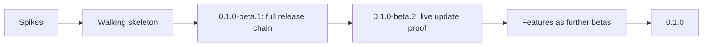

# Roadmap

> **Status:** `0.1.0-beta.1`, the walking skeleton below, was the first release; `0.1.0-beta.2` adds context menus and the keyboard shortcuts of each system. Everything after it is still a plan; scope and order may change as the work progresses.

## Vision

Astela aims to be a browser that feels like your own tool: it starts instantly, uses little memory and adapts to the way you work. Apart from that, it leaves you alone. It is designed to run on Windows, macOS and Linux on top of Chromium through Electron, and follows the [principles](architecture/principles.md) that guide every design decision.

## Priorities

Every feature has one priority, and each priority maps to a milestone:

| Priority | Milestone              | Meaning                                |
| -------- | ---------------------- | -------------------------------------- |
| P0       | M1 Foundation          | Required for the first stable release. |
| P1       | M2 Flow                | Planned for the second milestone.      |
| P2       | M3 Comfort             | Planned for the third milestone.       |
| P3       | M4 Ecosystem and later | Planned for M4 and later milestones.   |

The maintainers chose a set of features as the heart of Astela. They are marked **Team** in the [feature catalog](#feature-catalog) and are P0, at least in the basic form described in [M1 scope](#m1-scope-basic-form-of-the-team-features).

## Milestones

| Milestone       | Version                  | Scope                                                                          | Goal                                                           |
| --------------- | ------------------------ | ------------------------------------------------------------------------------ | -------------------------------------------------------------- |
| M1 Foundation   | `0.1.0-beta.N` → `0.1.0` | All P0 features, delivered in the [order described below](#m1-delivery-order). | A working, polished base browser that ships on every platform. |
| M2 Flow         | `0.2.0`                  | All P1 features.                                                               | The fastest way to work, with a built-in content blocker.      |
| M3 Comfort      | `0.3.0`                  | All P2 features.                                                               | An easy switch from other browsers.                            |
| M4 Ecosystem    | `0.4.0`                  | Extensions and the decision on a DRM-enabled variant.                          | Compatibility with the wider web ecosystem.                    |
| M5 Enterprise+  | `0.5.0`                  | Extended policies and an update service for MSI installations.                 | Rollout in organizations.                                      |
| M6 Sync and 1.0 | `1.0.0`                  | Sync, stabilization and complete documentation.                                | Stable API and data formats, ready for long-term support.      |

## M1 scope: basic form of the team features

M1 delivers exactly this basic form of each team feature, and nothing more. Everything in the last column comes later.

| Feature           | Basic form in M1                                                                                                                                                                             | Later                                                                             |
| ----------------- | -------------------------------------------------------------------------------------------------------------------------------------------------------------------------------------------- | --------------------------------------------------------------------------------- |
| Workspaces        | Create, rename and delete; icon from a built-in set, color and theme; switcher and shortcuts; optional isolated partition.                                                                   | Workspace rules (URL to workspace), a search engine and start page per workspace. |
| Themes            | Light, dark and system; accent presets plus a free accent color; 5 built-in themes; import and export; an editor for the token list (colors, radius) with live preview and contrast warning. | New tab background images, a local theme gallery.                                 |
| Density and fonts | 3 density levels; UI font and size; default web fonts.                                                                                                                                       | No expansion planned.                                                             |
| Toolbar           | Show, hide and reorder items in a list view (drag within the list); reset.                                                                                                                   | Dragging directly in the toolbar, multiple toolbars.                              |
| New tab page      | Background (color or image), manual tiles, search box and clock on or off.                                                                                                                   | Widgets.                                                                          |
| Search engines    | List, default engine, keywords, adding custom engines.                                                                                                                                       | OpenSearch discovery.                                                             |
| Shortcuts         | List of all commands, recording a key, showing conflicts, reset.                                                                                                                             | Chords.                                                                           |
| Settings          | Generated from the schema; search in English and German; export and import; policy lock.                                                                                                     | No expansion planned.                                                             |
| Tab bar           | 4 positions; collapsible when vertical; drag and drop between windows and workspaces; tear-off; groups (name, color, collapsible); pinned tabs.                                              | Tab stacks, tree view.                                                            |

## Feature catalog

The module column names the feature module that is designed to own the feature. See the [module system](architecture/modules.md) for how modules work.

### P0: M1 Foundation

| Area          | Feature                                                                                                                                                                                                                                                                                   | Modules                                                             |
| ------------- | ----------------------------------------------------------------------------------------------------------------------------------------------------------------------------------------------------------------------------------------------------------------------------------------- | ------------------------------------------------------------------- |
| Core          | Windows, tabs, navigation, omnibox (URL or search, suggestions from history, bookmarks and open tabs), find in page, per-site zoom, context menus, DevTools, printing through the system dialog, PDF viewer, full screen.                                                                 | `tabs`, `navigation`, `omnibox`                                     |
| Core          | Downloads (list, panel, open folder), history (list, search, delete), bookmarks (star, bar, manager), private window.                                                                                                                                                                     | `downloads`, `history`, `bookmarks`, `private-window`               |
| Core          | Session restore: lazy, with crash recovery, and exact after an update.                                                                                                                                                                                                                    | `session`                                                           |
| Core          | Site permissions: prompt in the overlay, a per-site list to review and revoke decisions. Enforcement (default deny) lives in the kernel and cannot be switched off.                                                                                                                       | `permissions` (UI only)                                             |
| Security      | HTTPS-First: upgrade to HTTPS, an interstitial to continue over HTTP, exceptions per host; DNS over HTTPS setting.                                                                                                                                                                        | `https-first`                                                       |
| Team          | Workspaces: name, icon, color and theme; quick switching through a switcher, shortcuts for the first nine workspaces (not with Ctrl+Alt or Option, which type characters on many layouts) and a command; optional isolated session.                                                       | `workspaces`                                                        |
| Team          | Layout presets: "Classic", "Vertical left", "Vertical right", "Bottom" and "Compact"; chosen on first start (non-modal, on the new tab page) and in settings; freely adjustable afterwards.                                                                                               | `layout`                                                            |
| Team          | Themes: light, dark and system; accent colors; theme files; a theme editor with live preview; import and export.                                                                                                                                                                          | `themes`, `theme-editor`                                            |
| Team          | Customization: UI density, fonts (UI and web defaults), a freely arrangeable toolbar, a customizable new tab page, search engines with keywords, custom keyboard shortcuts, schema-based settings that are searchable and exportable.                                                     | `toolbar`, `newtab`, `search-engines`, `keybindings`, `settings-ui` |
| Team          | Tab bar on the top, bottom, left or right (collapsible width when vertical), drag and drop between windows and workspaces, tear-off, tab groups, pinned tabs.                                                                                                                             | `tabstrip`, `tab-groups`                                            |
| Enterprise    | Policy engine for all three operating systems with about 22 policies; generated ADMX/ADML, mobileconfig and Linux JSON; per-machine silent MSI; DNS over HTTPS; proxy and PAC; auth server allowlist (Kerberos and NTLM); diagnostics page; local logs; manual safe mode; admin guide v1. | `policy`, `diagnostics`, `safe-mode`                                |
| Updates       | The complete update chain: signed feed, background download with delta updates, installation per package format, rollback. See [updates](architecture/updates.md).                                                                                                                        | `updates`                                                           |
| Cross-cutting | Internationalization: the UI ships in English and German, follows the system language and can be switched, and a new language needs only JSON files; accessibility basics (keyboard, screen readers, forced colors, reduced motion); no telemetry.                                        | `i18n`                                                              |

### P1: M2 Flow

| Area       | Feature                                                                                                                                                                                                                                                                               | Modules             |
| ---------- | ------------------------------------------------------------------------------------------------------------------------------------------------------------------------------------------------------------------------------------------------------------------------------------- | ------------------- |
| Security   | Strict HTTPS-Only mode, blocking third-party cookies, Global Privacy Control, removal of tracking parameters.                                                                                                                                                                         | `privacy`           |
| Enterprise | Jamf JSON schema, `ManagedBookmarks`, `AuthNegotiateDelegateAllowlist`, automatic safe mode after failed starts, a dictionary mirror. Until the mirror exists, spell checking is off on Windows and Linux so that no requests go to Google CDNs; macOS uses the system spell checker. | No dedicated module |
| Flow       | Command palette (commands, tabs, history, bookmarks, settings), tab search.                                                                                                                                                                                                           | `command-palette`   |
| Flow       | Split view with 2 to 4 panes, a layout tree, and drag and drop.                                                                                                                                                                                                                       | `split-view`        |
| Flow       | Tab sleep: on inactivity, under memory pressure or manually, with exceptions and an indicator.                                                                                                                                                                                        | `tab-sleep`         |
| Privacy    | Ad and tracker blocker (network and cosmetic filtering, per-site toggle, signed filter feeds); malware and phishing lists with an interstitial.                                                                                                                                       | `content-blocker`   |

### P2: M3 Comfort

| Area    | Feature                                                                                                                  | Modules                                       |
| ------- | ------------------------------------------------------------------------------------------------------------------------ | --------------------------------------------- |
| Comfort | Reader view, picture-in-picture button (video and Document Picture-in-Picture), mouse gestures, sidebar with web panels. | `reader`, `pip`, `gestures`, `sidebar-panels` |
| Comfort | Import of bookmarks, history and password CSV files from Chrome, Edge, Brave, Vivaldi, Opera, Firefox and Safari.        | `import`                                      |
| Comfort | Password manager with OS key storage, basic autofill, and CSV import and export.                                         | `passwords`                                   |

### P3: M4 and later

| Area        | Feature                                                                                                                                         | Modules             |
| ----------- | ----------------------------------------------------------------------------------------------------------------------------------------------- | ------------------- |
| Ecosystem   | Extensions: a Manifest V3 subset with a curated compatibility list.                                                                             | `extensions`        |
| Media       | Evaluation of a DRM-enabled variant (Widevine).                                                                                                 | Build flavor        |
| Enterprise+ | More than 50 policies, extension policies, an optional update service for MSI installations, a certificate UI, a VPAT and accessibility report. | No dedicated module |
| Sync        | End-to-end encrypted sync of bookmarks, settings and tabs, self-hostable.                                                                       | `sync`              |

## M1 delivery order

M1 is designed to reach users early and to prove the whole delivery chain before the features arrive. Work lands in small pull requests of roughly 400 changed lines, each with green checks.

### 1. Spikes

The riskiest technical questions are answered first, on branches. Their results flow into the [architecture decision records](adr/README.md); only clean code is merged.

1. A custom update provider with Ed25519 verification and delta updates for NSIS on Windows and AppImage on Linux, with measured delta sizes.
2. macOS updates with a self-signed certificate: Squirrel updates and keychain stability across updates.
3. The Chromium sandbox for AppImage on Ubuntu 24.04 and 26.04, which restrict unprivileged user namespaces, tested on a host runner with that restriction enabled.
4. APT and DNF repositories: installation, upgrade, and the version order from `~beta.N` to the stable release.
5. `node:sqlite` in a utility process with FTS5, WAL and `VACUUM INTO` on 3 operating systems and 2 architectures.
6. An inventory of the web platform APIs that the packaged build exposes.
7. Moving a tab between windows without a reload on Windows, macOS, X11 and Wayland.

### 2. Walking skeleton: `0.1.0-beta.1`

The first beta is a minimal browser (windows, tabs, omnibox and the security baseline) that already runs through the **complete** package, update, release and website chain. It is built in this order:

| Step | Increment          | Content                                                                                                                                                                           |
| ---- | ------------------ | --------------------------------------------------------------------------------------------------------------------------------------------------------------------------------- |
| 1    | Kernel             | Dependency injection container, `ModuleHost`, event bus, lifecycle, logging.                                                                                                      |
| 2    | Core domain        | Settings and policy domain; policy providers that load synchronously before the app is ready; code generation for JSON Schema, ADMX/ADML, mobileconfig, Linux JSON and docs.      |
| 3    | Platform           | `BaseWindow` and `WebContentsView`, the `app://` scheme, `IpcRouter`, the security baseline (fuses, CSP, permission and navigation guards), `BootGuard`, safe mode, logs.         |
| 4    | Shell              | A minimal shell (tabs on top, toolbar, omnibox), the overlay, and the internationalization basics for English and German.                                                         |
| 5    | Packaging          | Every package format and architecture, package smoke tests, the end-to-end test skeleton on 3 operating systems, and the performance harness with a bare Electron reference.      |
| 6    | Updates            | Signed feed, custom provider, an installer per package format, rollback, the migration framework, updater tests.                                                                  |
| 7    | Linux repositories | APT and DNF repositories including beta suites, with upgrade order tests.                                                                                                         |
| 8    | Release pipeline   | Release and website workflows; a website skeleton with landing page, download page built from release data, docs, API reference and changelog; screenshot job; live verification. |
| 9    | `0.1.0-beta.1`     | The first beta release, meeting the complete Definition of Done.                                                                                                                  |

### 3. Live update proof: `0.1.0-beta.2`

The second beta is designed to prove a real update on installed systems. Once `0.1.0-beta.2` is released, the release workflow will prove that an installed `0.1.0-beta.1` updates itself to it through the live feed (NSIS on Windows, AppImage on Linux) and that its deb and rpm packages upgrade through the live APT and DNF repositories. Every later release will be proven the same way from the newest earlier release of its channel, and the first stable release from the newest beta. macOS joins once the macOS updater test exists (see [testing](architecture/testing.md#special-cases)).

### 4. Features as further betas

The P0 features follow in about 20 small pull requests. Every few pull requests, a new `0.1.0-beta.N` will be released, each meeting the complete Definition of Done:

- **Tabs:** the full tab model (4 positions, collapsible vertical bar, groups, pinned tabs), drag and drop across windows and workspaces, tear-off.
- **Workspaces and session:** workspaces including isolated partitions; lazy session restore and crash recovery.
- **Data:** the data service, history, bookmarks, downloads, private window.
- **Appearance:** the [design system](architecture/design-system.md) (tokens, density, fonts) and layout presets; the theme engine, built-in themes, the theme editor, import and export.
- **Settings and customization:** the settings page (search, export and import, policy lock); toolbar editor, new tab page, search engines, shortcut editor.
- **Security and enterprise:** permissions UI, HTTPS-First, DNS over HTTPS; enterprise policies, proxy and authentication, MSI properties, the diagnostics page and admin guide v1. See [enterprise](architecture/enterprise.md).
- **Completion:** full accessibility and internationalization coverage.

### 5. Release `0.1.0`

When every P0 feature meets its acceptance criteria, `0.1.0` is released on the stable channel. The upgrade path `0.1.0-beta.1` → `0.1.0-beta.2` → `0.1.0` must work for NSIS, AppImage, deb and rpm; deb and rpm packages encode betas as `0.1.0~beta.N` so that they sort before the final release. MSI packages are built for stable releases only, so `0.1.0` will be the first release with an MSI package.

## M1 acceptance criteria

`0.1.0` will be released only when every criterion below holds. Each criterion is designed as an automated test unless marked otherwise.

- **Start-up and performance:** every budget in [performance](architecture/performance.md) is met on all three operating systems.
- **Tabs:** opening and closing 100 tabs leaves memory at no more than 110 % of the starting value; `Ctrl/Cmd+Shift+T` restores closed tabs.
- **Tab bar:** the position changes between top, bottom, left and right live, without a restart, and all 4 positions are compared with screenshots; the tab strip is fully operable by keyboard; the vertical bar collapses and expands.
- **Drag and drop:** a tab dragged between two windows keeps its page state (scroll position, form content), because its view is re-attached; dropping it on a workspace icon moves it, and dropping it outside every window opens a new window; groups and pinned tabs stay consistent.
- **Workspaces:** a workspace can be created and renamed, and its icon, color and theme can be set; switching takes at most 100 ms with 20 tabs; in an isolated workspace, a cookie from one workspace is not visible in another, and sign-ins stay separate.
- **Themes:** an import takes effect immediately; exporting and re-importing a theme is byte-identical; a change in the editor is visible in less than 100 ms; the editor warns below a contrast of 4.5:1; a per-workspace theme switches with its workspace.
- **Settings:** every setting can be found by its English title, its German title and its keywords; the export and import round trip is lossless; values locked by policy cannot be changed in the UI or the API and are shown as managed.
- **Toolbar and new tab page:** toolbar items can be arranged and removed by drag and drop, and the toolbar can be reset; the new tab background, tiles and layout are adjustable, without sponsored content.
- **Search engines:** engines can be added, the default can be set, and keyword search (`w term`) works; the default can also be set by policy.
- **Keyboard shortcuts:** every command can be rebound, and conflicts are shown; shortcuts also work while web content has focus; the defaults follow each platform's conventions.
- **Session:** after a restart or an update, all windows, workspaces, groups and tabs are back, and only visible tabs load; restoring 100 tabs stays within the startup budget plus 150 ms; after a crash, the session is restored without a modal dialog.
- **Private window:** no history, no download history and no cookies remain after it closes; it uses its own in-memory partition.
- **Downloads, history and bookmarks:** the basic functions are covered by end-to-end tests; full-text search in the history answers in less than 50 ms with 100,000 entries.
- **Enterprise:** silent per-machine MSI installation, upgrade and uninstallation exit with code 0; policies from the registry, plist files and JSON files take effect and appear on `app://diagnostics`; the ADMX/ADML templates validate against the XSD, and maintainers check the Intune import manually once per minor release; `--safe-mode` starts without optional modules and custom themes. See [enterprise](architecture/enterprise.md).
- **Updates:** every updater scenario in [testing](architecture/testing.md) passes on Windows (NSIS) and Linux (AppImage, deb, rpm), and on macOS depending on the code signing status; the upgrade order `0.1.0-beta.1` → `0.1.0-beta.2` → `0.1.0` works for NSIS, AppImage, deb (`0.1.0~beta.N`) and rpm.
- **Network:** proxy modes, including a local PAC file, are tested against a test proxy; DNS over HTTPS against a local DNS over HTTPS stub; Kerberos and Negotiate against an MIT KDC and a web server in a container on Linux; a custom root certificate authority in the Windows certificate store and in the NSS database on Linux.
- **Permissions:** camera, microphone, location and notifications are denied without consent, even with the `permissions` module disabled and in safe mode; revoking a permission in the list takes effect immediately.
- **No telemetry:** a network capture during 60 s of idle time after start shows no connections other than the allowlisted ones (the update feed check after 30 to 60 s).
- **Omnibox, find in page and zoom:** URLs and searches are told apart correctly; suggestions from history, bookmarks and open tabs appear in less than 30 ms; find in page and per-site zoom are saved.
- **Diagnostics and logs:** `app://diagnostics` shows every required field, and its export is redacted; logs rotate at 5 MB × 3 files.
- **Layout presets:** each preset produces its reference layout (screenshot diff), and the choice on first start is non-modal.
- **Internationalization:** 100 % of the keys exist in English and German; the language follows the system and can be switched; a third language can be added with JSON files alone (tested with a pseudo-locale).
- **Accessibility:** axe reports no serious or critical issues, and accessibility tree snapshots serve as regression tests; the browser is fully operable by keyboard (F6 cycles from the toolbar to the tabs to the content); maintainers run a screen reader smoke test with NVDA, VoiceOver and Orca once per minor release, as described in [WORKFLOW.md](maintainers/WORKFLOW.md).
- **Release:** a merge with a version bump produces the release, the packages, the update feed, the package repositories and the website without manual steps.

## Related documents

- [Principles](architecture/principles.md)
- [Architecture overview](architecture/overview.md)
- [Performance](architecture/performance.md)
- [Testing](architecture/testing.md)
- [Architecture decision records](adr/README.md)
